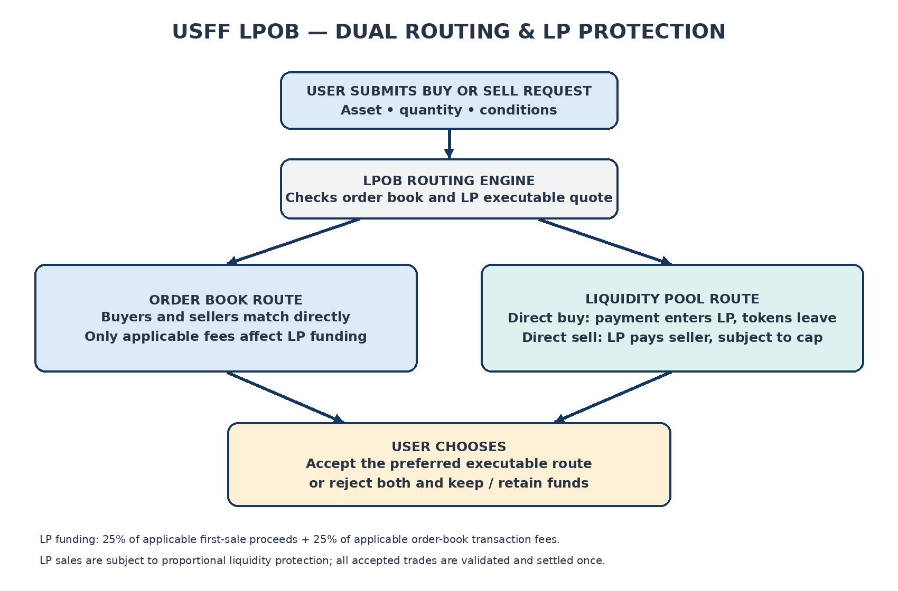

_This white paper has been prepared in compliance with the requirements of the Commission Implementing Regulation 2024/2984 of 29 November 2024 implementing technical standards for the application of Regulation (EU) 2023/1114 of the European Parliament and of the Council with regard to forms, formats and templates for the crypto-asset white papers_

**Universal Standard Franc (USFF) token white paper**

| **No** | **FIELD** | **CONTENT** |
|---|---|---|
| **00** | **Table of Content** | **SUMMARY** **Part A - Information about the offeror or the person seeking admission to trading** 1. Name 2. Legal Form 3. Registered address 4. Head office 5. Registration date 6. Legal entity identifier 7. Another identifier required pursuant to applicable national law 8. Contact telephone number 9. E-mail address 10. Response time (Days) 11. Parent company 12. Members of the management body 13. Business Activity 14. Parent company business activity 15. Newly established 16. Financial condition for the past three years 17. Financial condition since registration **Part B - Information about the issuer, if different from the offeror or person seeking admission to trading** **Part C - Information about the operator of the trading platform in cases where it draws up the crypto-asset white paper and information about other persons** **Part D - Information about the crypto-asset project** 1. Crypto-asset project name 2. Crypto-assets name 3. Abbreviation 4. Crypto-asset project description 5. Details of all natural or legal persons involved in the implementation of the crypto-asset project 6. Utility Token Classification 7. Key Features of Goods/Services for Utility Token Projects 8. Plans for the token 9. Resource Allocation 10. Planned use of Collected funds or crypto-Assets **Part E - Information about the offer to the public of crypto-assets or their admission to trading** 1. Public offering or admission to trading 2. Reasons for public offer or admission to trading 3. Fundraising target 4. Minimum subscription goals 5. Maximum subscription goals 1. Oversubscription acceptance 2. Oversubscription allocation 3. Issue price 4. Official currency or any other crypto-assets determining the issue price 5. Subscription fee 6. Offer price determination method 7. Total number of offered/traded crypto-assets 8. Targeted holders 9. Holder restrictions 10. Reimbursement notice 11. Refund mechanism 12. Refund timeline 13. Offer phases 14. Early purchase discount 15. Time-limited offer 16. Subscription period beginning 17. Subscription period end 18. Safeguarding arrangements for offered funds/crypto-Assets 19. Payment methods for crypto-asset purchase 20. Value transfer methods for reimbursement 21. Right of withdrawal 22. Transfer of purchased crypto-assets 23. Transfer time schedule 24. Purchaser's technical requirements 25. Crypto-asset service provider (CASP) name 26. CASP identifier 27. Placement form 28. Trading platforms name 29. Trading platforms Market identifier code (MIC) 30. Trading platforms access 31. Involved costs 32. Offer expenses 33. Conflicts of interest 34. Applicable law 35. Competent court **Part F - Information about the crypto-assets** 1. Crypto-asset type 2. Crypto-asset functionality 3. Planned application of functionalities 4. Type of crypto-asset white paper 5. The type of submission 6. Crypto-asset characteristics 7. Commercial name or trading name 8. Website of the issuer 9. Starting date of offer to the public or admission to trading 10. Publication date 11. Any other services provided by the issuer 12. Language or languages of the crypto-asset white paper 13. Digital token identifier code used to uniquely identify the crypto-asset or each of the several crypto assets to which the white paper relates, where available 1. Functionally fungible group digital token identifier, where available 2. Voluntary data flag 3. Personal data flag 4. LEI eligibility 5. Home Member State 6. Host Member State **Part G - Information on the rights and obligations attached to the crypto-assets** 1. Purchaser rights and obligations 2. Exercise of rights and obligations 3. Conditions for modifications of rights and obligations 4. Future public offers 5. Issuer retained crypto-assets 6. Utility token classification 7. Key features of goods/services of utility tokens 8. Utility tokens redemption 9. Non-trading request 10. Crypto-assets purchase or sale modalities 11. Crypto-assets transfer restrictions 12. Supply adjustment protocols 13. Supply adjustment mechanisms 14. Token value protection schemes 15. Token value protection schemes description 16. Compensation schemes 17. Compensation schemes description 18. Applicable law 19. Competent court **Part H – Information on the underlying technology** 1. Distributed ledger technology (DLT) 2. Protocols and technical standards 3. Technology used 4. Consensus mechanism 5. Incentive mechanisms and applicable fees 6. Use of distributed ledger technology 7. DLT functionality description 8. Audit 9. Audit outcome 10. LPOB — LIQUIDITY POOL & ORDER BOOK **Part I – Information on risks** 1. Offer-related risks 2. Issuer-related risks 3. Crypto-assets-related risks 4. Project implementation-related risks 5. Technology-related risks 6. Mitigation measures **Part J – Information on the sustainability indicators in relation to adverse impact on the climate and other environment-related adverse impacts** 1. Adverse impacts on climate and other environment-related adverse impacts |
| **01** | **Date of Notification** | 2026-04-13 |
| **02** | **Statement in accordance with Article 6(3) of Regulation (EU) 2023/1114** | This crypto-asset white paper has not been approved by any competent authority in any Member State of the European Union. In accordance with Regulation (EU) 2023/1114, no prior authorization or approval is required for the publication of this crypto-asset white paper. The issuer of the crypto-asset is solely responsible for the content of this white paper. The information contained herein has been prepared in good faith and is intended to be fair, clear and not misleading. |
| **03** | **Compliance statement in accordance with Article 6(6) of Regulation (EU) 2023/1114** | This crypto-asset white paper has been prepared in accordance with Title II of Regulation (EU) 2023/1114 of the European Parliament and of the Council. To the best of the knowledge of the issuer and its management body, the information contained in this crypto-asset white paper is fair, clear and not misleading and does not omit anything likely to affect its import. The issuer confirms that this crypto-asset white paper complies with the applicable requirements set out in Regulation (EU) 2023/1114 in relation to the offering of crypto-assets to the public and/or their admission to trading on a trading platform. |
| **04** | **Statement in accordance with Article 6(5), points (a), (b), (c), of Regulation (EU) 2023/1114** | The crypto-asset described in this crypto-asset white paper may lose its value in part or in full and may be subject to significant price volatility. The crypto-asset may not always be transferable and may not be liquid. There is no guarantee that a market will develop or be maintained, and holders may not be able to sell or exchange the crypto-asset at their desired time or price. |
| **05** | **Statement in accordance with Article 6(5), point (d), of Regulation (EU) 2023/1114** | The utility token described in this crypto-asset white paper may not be exchangeable for the goods or services referred to in this white paper. The ability to use the utility token depends on the development, availability and continued operation of the crypto-asset project and its associated ecosystem. There is no guarantee that the crypto-asset project will be successfully developed, maintained or continued. In the event of a failure, suspension or discontinuation of the project, the utility token may lose its utility, in whole or in part. |
| **06** | **Statement in accordance with Article 6(5), points (e) and (f), of Regulation (EU) 2023/1114** | The crypto-asset described in this crypto-asset white paper is not covered by any investor compensation scheme established under Directive 97/9/EC of the European Parliament and of the Council. The crypto-asset is also not covered by any deposit guarantee scheme established under Directive 2014/49/EU of the European Parliament and of the Council. Accordingly, holders of the crypto-asset will not benefit from any statutory compensation or protection scheme in the event of losses. |
| **07** | **Warning in accordance with Article 6(7), second subparagraph, of Regulation (EU) 2023/1114** | Warning: This summary should be read as an introduction to the crypto-asset white paper. Any decision to purchase the crypto-asset should be based on a consideration of the crypto-asset white paper as a whole and not on the summary alone. The offer to the public of this crypto-asset does not constitute an offer or solicitation to purchase financial instruments. Any such offer or solicitation may be made only by means of a prospectus or other offering documents in accordance with applicable law. This crypto-asset white paper does not constitute a prospectus within the meaning of Regulation (EU) 2017/1129 of the European Parliament and of the Council, nor any other offering document pursuant to Union or national law. |
| **08** | **Characteristics of the crypto-asset** | The crypto-asset "USFF" (Universal Standard Franc) is a native Layer-1 utility and transactional cryptocurrency operating on its own independent UTXO-based Proof-of-Work (PoW) blockchain (derived from Bitcoin/Litecoin Core 0.21.2.2 architecture). USFF is intended to function as an independent digital medium of exchange, settlement layer, and computational accounting unit across decentralized networks, Web3 commerce applications, peer-to-peer settlement, and integrated digital services. USFF does not represent any ownership right, shareholding, or equity interest in the issuer or in any affiliated entity. It does not grant governance rights, voting rights, or entitlement to dividends, profits, or revenue. The token is designed as a utility and medium-of-exchange instrument only and should not be considered a financial instrument, security, or investment product. |
| **09** | **Holders of USFF rights and obligations** | Holders of USFF do not acquire any rights or obligations vis-à-vis the issuer or any related entity, except for the ability to use the token within the Universal Standard Franc network and supporting ecosystem, subject to availability and functionality. USFF does not grant: • governance or voting rights, • enforceable claims against the issuer, • rights to profits, revenues, or distributions, • ownership or equity rights. The utility of USFF is limited to its intended transactional use within the ecosystem and depends on the continued operation and maintenance of the decentralized blockchain network. |
| **10** | **Key information about the offer to the public or admission to trading** | The USFF cryptocurrency operates as a native digital asset on its own independent Layer-1 UTXO Proof-of-Work blockchain network. As of 17 March 2026, the USFF cryptocurrency is available for trading and peer-to-peer exchange across decentralized protocols, liquidity infrastructures, secondary market venues, and supported exchange environments. Trading pairs such as USFF/USDC, USFF/USDT, and USFF/BTC may be used to facilitate market access and decentralized price discovery. Access to USFF and transaction execution is conducted through compatible non-custodial node software (USFrancCore v0.1.0) and compatible UTXO wallets (supporting P2PKH, P2SH, and Bech32 Native SegWit addresses). These decentralized and secondary trading venues enable users to access liquidity directly through on-chain protocols. However, trading conditions, including price, liquidity, and execution, are subject to market dynamics and third-party platform functionality. The issuer may, at a later stage, seek admission of the USFF token to centralized cryptocurrency exchanges (CEX). Any such listings remain subject to the approval, requirements, and discretion of the respective platforms. There is no guarantee that USFF will be listed on additional trading platforms, nor that any specific level of liquidity, trading volume, or market price will be achieved or maintained. The total supply of USFF is fixed at 90,000,000,000 USFF with 8 decimal places of precision, fully issued at Block 1 with zero ongoing inflationary block subsidies. Allocation structure and distribution are defined within this white paper and may be implemented progressively in line with ecosystem development and market demand. |

# **Issuer**

# **USFranc Project (Universal Standard Franc Ecosystem)**

The USFF crypto-asset is issued and administered within Europe by:
SAS Association Familiale Fin (AFFIN)
Registration No: 80396522700017 (RCS Montpellier)
Registered Office: 8 Rue Dublin, 34200 Sète, France
President: Brian Edmond Patrick Fin
Administrator: Brian Edmond Patrick Fin
Qualifications: MScFSM / Dip GRC / Dip. Marketing Management (IMM)

The project is supported by:
USFRANC LTD
Registered Office: 4th Floor, Silverstream House, 45 Fitzroy Street, London, W1T 6EB, United Kingdom
Chief Executive Officer (CEO): Brian Edmond Patrick Fin
Brian Edmond Patrick Fin also acts as Director of SAS Association Familiale Fin (AFFIN) and Administrator of the USFranc project.

The issuer is solely responsible for the content of this crypto-asset white paper in accordance with Regulation (EU) 2023/1114.

_Part A - Information about the offeror or the person seeking admission to trading_

| **No** | **FIELD** | **CONTENT** |
|---|---|---|
| **A.1** | **Name** | SAS Association Familiale Fin (Affin) |
| **A.2** | **Legal Form** | Société par actions Simplifiée (SAS), incorporated under French law registered with RCS Montpellier under number 80396522700017 |
| **A.3** | **Registered address** | 8 rue de Dublin 34200 Sète France |
| **A.4** | **Head office** | Same as registered address |
| **A.5** | **Registration date** | 03/09/2014 |
| **A.6** | **Legal entity identifier** | 80395622700017 |
| **A.7** | **Another identifier required pursuant to applicable national law** | French tax identification number (SIREN) 803965227 |
| **A.8** | **Contact telephone number** | +0033666100010 |
| **A.9** | **E-mail address** | affin@bobosohomail.com |
| **A.10** | **Response time (Days)** | 24 hours |
| **A.11** | **Parent company** | Not applicable |
| **A.12** | **Members of the management body** | President: Brian Edmond Patrick Fin Nationality: French Functions: President of SAS Association Familiale Fin (AFFIN) Administrator of the USFF ecosystem Chief Executive Officer (CEO) of USFRANC LTD Qualifications: MScFSM – University of Salford Diploma in Governance, Risk & Compliance (Dip GRC) – International Compliance Association (ICA) Diploma in Marketing Management (Dip. Mkt. Man. IMM) – Durban University / IMM Graduate School |
| **A.13** | **Business activity** | SAS Association Familiale Fin (AFFIN) is a French holding company engaged in capital investments, equity participation, and digital asset activities, including cryptocurrencies and blockchain-based technologies. The company manages its subsidiaries and investment portfolio, including activities in real estate investment, property development, and commercial operations. AFFIN is actively involved in research and development (R&D) in the fields of cybersecurity, crypto-asset security, and blockchain infrastructure. This includes the design, development, and support of technologies related to secure digital asset management, anti-intrusion systems, and crypto audit frameworks. Through its internal and affiliated structures, AFFIN supports the development of cybersecurity solutions, blockchain ecosystems, and digital financial infrastructure, including the USFranc (USFF) ecosystem and related platforms, including proprietary cybersecurity systems and blockchain security protocols developed internally. The company operates both directly and through its controlled entities, overseeing strategic investments, project development, and ecosystem growth within the fields of technology, digital assets, and financial innovation. |
| **A.14** | **Parent company business activity** | Not applicable |
| **A.15** | **Newly established** | The company was incorporated on 03 September 2014 |
| **A.16** | **Financial condition for the past three years** | The company has maintained stable financial operations over the past three years, funded through its own capital resources and internal revenues. AFFIN has operated without reliance on external financing or institutional investors, maintaining a conservative financial structure. Further details on the financial condition of the company are provided in section A.17. |
| **A.17** | **Financial condition since registration** | Since its incorporation, SAS Association Familiale Fin (AFFIN) has operated as a privately owned and self-funded holding company. The company has not raised external capital and does not rely on third-party investors or institutional financing. AFFIN is owned through a private family trust structure under the control of Brian Edmond Patrick Fin. AFFIN maintains a conservative financial structure with no outstanding credit facilities, debt obligations, or external financial liabilities. The company’s activities are funded through its own capital resources and revenues generated from its investment activities and subsidiaries. AFFIN holds and manages a diversified portfolio of assets, including real estate investments (property holdings), technology ventures, and digital asset projects. The company is actively involved in research and development (R&D) in cybersecurity, crypto-asset security, blockchain infrastructure, and crypto audit systems. AFFIN operates both directly and through its controlled entities, overseeing strategic investments, project development, and ecosystem growth across its various sectors. The company’s financial strategy is based on long-term capital preservation, controlled growth, and reinvestment into its ecosystem and technological development. |

# **Part B**

**_Information about other persons involved in the crypto-asset project_**

# **Part C**

**_The crypto-asset project described in this white paper is developed, managed, and operated within the AFFIN group structure. In accordance to Article 6(1), second subparagraph, of Regulation (EU) 2023/1114, the following entities are involved in the administration, development, and strategic oversight of the project._**

Role: Holding Company / Strategic Management / Treasury & Reserve Oversight
Registered Address: 8 Rue de Dublin, 34200 Sète, France (Registration Number: 803 965 227 RCS Montpellier)
Description:
AFFIN acts as the principal holding and management entity of the ecosystem. It oversees capital allocation, reserve management, investment strategy, and long-term development of the crypto-asset infrastructure. The company also manages subsidiaries in property, technology, and digital asset development.

Role: Crypto-asset Development / Blockchain Infrastructure / Network Operations
Registered Address: 4th Floor, Silverstream House, 45 Fitzroy Street, London, W1T 6EB, United Kingdom
Description:
USFRANC LTD is responsible for the technical development, deployment, and operation of the blockchain infrastructure, including wallet systems, transaction processing, and network coordination.

Role: Research & Development / Cybersecurity / Blockchain Security / Crypto Audit
Description:
The AFFIN group conducts internal research through its own subsidiary and development activities focused on cybersecurity, crypto-asset security, and blockchain infrastructure. This includes the development of proprietary technologies within the Bitss ecosystem, smart contract systems, crypto security, crypto audits transaction validation and audit mechanisms designed to ensure security, integrity, and transparency.

The project does not rely on external third-party entities for its core development, issuance, or operational management. All strategic, technical, and financial functions are conducted internally within the AFFIN group, ensuring full control crypto-assets ecosystem.

# **Acquisition Rights and Decentralized Market Pricing**

The founders of USFF, Brian Fin and Association Familiale Fin (AFFIN), have received no USFF tokens free of charge and hold no complimentary or undisclosed founder allocation.
Brian Fin and Association Familiale Fin retain the right to acquire USFF directly, without any fixed purchase deadline, expiration date, or limitation on the period during which this right may be exercised.
Any USFF acquired by the founders constitutes a purchase and not a free allocation, grant, reward, or promotional distribution.
USFF is intended to operate as a decentralized token, with its market price determined by the actual supply and demand expressed through the applicable trading mechanisms and order books. Buy and sell orders may cause the market price to fluctuate continuously.
The token price is therefore not a fixed value determined by the founders, and no guaranteed market price or future valuation is implied.
The founders’ right to acquire USFF does not constitute a commitment to purchase any specific quantity, does not guarantee a particular acquisition price, and does not provide a guaranteed market value or return. All acquisitions remain subject to the applicable USFF purchase and network rules.

_Part D - Information about the crypto-asset project_

| **No** | **FIELD** | **CONTENT** |
|---|---|---|
| **D.1** | **Crypto-asset project name** | Universal Standard Franc (USFranc) ecosystem |
| **D.2** | **Crypto-assets name** | Universal Standard Franc |
| **D.3** | **Abbreviation** | USFF |
| **D.4** | **Crypto-asset project description** | The Universal Standard Franc (USFF) project is an independent Layer-1 distributed ledger protocol designed to deliver a high-throughput, secure, and predictable medium of exchange and computational store of value. The project integrates traditional e-commerce functionality with native blockchain-based infrastructure, allowing users to operate online shops, list products, publish content, and transact using digital assets. The platform supports both individual users and businesses, providing scalable tools for digital commerce and marketplace participation. The USFF token is a utility and transactional token used within the ecosystem. It facilitates transactions, access to platform features, and participation in ecosystem services. The token may be used for payments, promotional incentives, platform fees, and user engagement mechanisms. The ecosystem is designed to operate across multiple layers, including: • A transaction and settlement environment for goods, services, and digital products • Integration with UTXO and Web3 wallets for asset ownership and transfers • Blockchain-based transaction mechanisms, including secure payment flows • Interoperability with external platforms and decentralized applications where applicable The project may incorporate additional features such as creator and merchant tools for digital storefronts, incentive mechanisms to encourage platform activity, and integration with decentralized finance (DeFi) services to enhance liquidity and accessibility. The Universal Standard Franc ecosystem does not grant ownership rights, equity participation, or guaranteed financial returns to token holders. The USFF token is intended solely for use within the ecosystem as a functional utility asset. All features and integrations will be deployed progressively and remain subject to technical development, market conditions, and regulatory compliance requirements. |
| **D.5** | **Details of all natural or legal persons involved in the implementation of the crypto-asset project** | The Universal Standard Franc project is developed, managed, and operated within the AFFIN group structure. The following entities are involved in the implementation, development, and strategic oversight of the project: AFFIN (SAS Association Familiale Fin) Role: Holding Company / Strategic Management / Treasury & Reserve Oversight Registered Address: 8 Rue de Dublin, 34200 Sète, France (Registration Number: 803 965 227 RCS Montpellier) Description: AFFIN acts as the principal holding and management entity of the ecosystem. It oversees capital allocation, reserve management, investment strategy, and long-term development of the crypto-asset infrastructure. The company is fully privately owned through a fiduciary structure and does not rely on external investors or credit financing. AFFIN also manages subsidiaries across property, technology, and digital asset development sectors. BFIN SASU Role: Operational Management / Development Coordination / Technical Execution Registered Address: France (as per registration, Registration Number: 535 217 731 RCS Montpellier) Description: BFIN SASU is responsible for operational execution, development coordination, and infrastructure management. This includes platform development, system integration, hosting infrastructure, and ongoing technical support. USFRANC LTD Role: Blockchain Development / Wallet Infrastructure / Network Operations Registered Address: 4th Floor, Silverstream House, 45 Fitzroy Street, London, W1T 6EB, United Kingdom Description: USFRANC LTD is responsible for blockchain-related infrastructure, including client software (USFrancCore), wallet systems, transaction processing environments, and network coordination across the ecosystem. AFFIN Group – Internal R&D Division (Bitss / Cybersecurity) Role: Research & Development / Cybersecurity / Blockchain Security / Crypto Audit Description: The AFFIN group conducts internal research and development activities focused on cybersecurity, crypto-asset protection, blockchain infrastructure, and transaction validation systems. This includes proprietary technologies developed within the Bitss ecosystem, covering malware protection, script security, and audit mechanisms. The project does not rely on external third-party entities for its core development, issuance, or operational management. All strategic, technical, and financial functions are conducted internally within the AFFIN group. |
| **D.6** | **Utility Token Classification** | The USFF token is classified as a utility token within the meaning of Regulation (EU) 2023/1114 (MiCA). The token is designed solely to provide access to, and facilitate the use of, services within the USFranc ecosystem. It enables users to interact with platform features, including payments, marketplace participation, and access to digital services. The USFF token does not: • Grant ownership rights in any entity • Provide equity participation or voting rights • Entitle holders to dividends, profits, or financial returns • Represent a claim on assets, reserves, or revenue streams The token is not intended to function as: • A financial instrument • Electronic money (e-money) • A security token Its primary purpose is functional use within the ecosystem, including: • Payment for goods and services • Access to platform features and tools • Participation in promotional and incentive mechanisms • Ecosystem engagement and user interaction All uses of the USFF token remain subject to applicable laws, regulatory requirements, and platform terms of use. |
| **D.7** | **Key Features of Goods/Services for Utility Token Projects** | The USFF token is designed to operate within the Universal Standard Franc ecosystem as a functional utility and transactional token, enabling access to a range of digital services, marketplace features, and Web2/Web3 integrations. The core components of the ecosystem include: Marketplace Infrastructure The ecosystem provides a digital environment where users can buy, sell, and promote goods and services. This includes both Web2 and Web3-compatible listings, allowing individuals and businesses to operate online shops and classified advertisements. USFF is used within the marketplace as: • A payment method for goods and services • A mechanism to unlock additional listing capacity • A tool to activate premium shop features and seller tools Digital Shop Creation & E-Commerce Integration Users can create and manage their own online shops within the ecosystem. USFF enables: • Activation of shop functionality • Access to enhanced product visibility • Integration with e-commerce tools powered by the ecosystem The system is designed to support scalable online business activity without reliance on third-party marketplace providers. Advertising & Listing Services USFF is used to enhance visibility within the platform: promotion of listings, priority placement within categories, and access to extended advertising features. Payment & Transaction Layer USFF functions as a transactional utility token within the ecosystem, supporting peer-to-peer payments, merchant transactions, and internal platform exchanges. Incentive & Engagement Mechanisms The token may be used within the ecosystem to reward user activity, support promotional campaigns, and encourage platform participation. Web2 / Web3 Integration Layer The ecosystem bridges traditional web services and blockchain-enabled environments. USFF enables interaction across marketplace platforms, digital services, and wallet-based transactions. The USFF token is strictly limited to utility functions within the ecosystem and does not grant any ownership rights, financial returns, or governance control over the platform or its entities. |
| **Legal** | **Legal & Consulting / Administration** | The administration and legal oversight of the USFF crypto-asset project are conducted internally within the AFFIN group structure. Primary Administrator: Brian Fin, Administrator and Project Lead AFFIN Group (Registered Address: 8 Rue de Dublin 34200 Sète France). Legal & Regulatory Support: The project benefits from legal and regulatory advisory services coordinated through the AFFIN group and its appointed legal consultants. These advisory functions include regulatory compliance (MiCA and applicable frameworks), legal structuring of the crypto-asset project, and contract oversight. |
| **D.8** | **Plans for the token** | The USFF token is designed to support the progressive development and expansion of the Universal Standard Franc ecosystem. Its primary function is to enable access to platform services, facilitate transactions, and support marketplace growth. Marketplace Expansion: The token will be increasingly integrated into e-commerce and marketplace environments for purchasing goods and services, unlocking advanced listing capabilities, and activating digital shops. E-Commerce & Business Integration: USFF will be integrated into e-commerce tools, enabling businesses and individual sellers to accept USFF as a payment method, access commercial features, and operate independently. Advertising & Visibility Tools: Future developments include enhanced advertising systems powered by USFF to promote listings and access premium placement. Platform Incentives & User Engagement: USFF may be used to support ecosystem engagement through promotional campaigns and participation rewards. Wallet & Payment Integration: USFF is compatible with supported digital wallets, enabling secure storage, peer-to-peer transfers, and platform integrations. Liquidity & Accessibility: USFF may be made available on selected trading platforms or exchange environments to improve accessibility and usability. No Guarantee of Financial Return: The USFF token is not designed as an investment product. It does not provide rights to profits, revenue, or ownership. |
| **D.9** | **Resource Allocation** | The Universal Standard Franc ecosystem operates with a structured financial strategy designed to ensure sustainable development, operational stability, and long-term platform growth. Use of Resources: Funds generated through the USFF token ecosystem will be allocated across the following key categories: • Platform Development (R&D): Continuous development and enhancement of the core platform, including client software (USFrancCore), marketplace infrastructure, user interface, security systems, and integration of Web2 and Web3 functionalities. • Operational Expenses: Covering infrastructure hosting, technical maintenance, cybersecurity (including Bitss integration), administrative operations, and personnel required to support daily platform activities. • Ecosystem Growth & Expansion: Supporting onboarding of sellers, businesses, and users, as well as partnerships, marketplace expansion, and international growth initiatives. • Marketing & User Acquisition: Promotion of the platform through digital campaigns, strategic partnerships, and visibility tools to drive adoption and marketplace activity. • Platform Incentives: Development of promotional campaigns, user engagement initiatives, and ecosystem participation incentives. • Treasury Management: Maintaining financial reserves in fiat and digital assets to ensure operational continuity, risk management, and long-term sustainability. Budgeting & Financial Planning: The ecosystem follows a structured low-cost optimizing controlled budgeting approach. Financial planning is designed to prioritize long-term platform development over short-term expenditure. |
| **D.10** | **Planned use of Collected funds or crypto-Assets** | Funds collected through the USFF token ecosystem will be primarily used to support the development, operation, and expansion of the Universal Standard Franc platform. Primary allocation includes: • Platform Development: Enhancement of marketplace systems for creators, builders, producers, manufacturers, and resellers to present their products on a low-cost market platform, online shop creation tools, payment integration, and user experience improvements. • Infrastructure & Technology: Server infrastructure, hosting services (including Bfinit), security layers, and system scalability. • Marketing & Growth: User acquisition campaigns, brand development, partnerships, and expansion of marketplace visibility. • Operational Costs: Administrative management, legal and compliance support, and operational staffing. • Ecosystem Expansion: Development of new features, services, and integrations to increase platform utility and adoption. • Liquidity & Accessibility: Facilitating access to the USFF token through selected platforms or exchange environments, where applicable and compliant. No Guarantee of Returns: The allocation of funds does not entitle token holders to profits, revenues, or financial returns. All funds are used exclusively to support the ecosystem’s development and operations. |

_Part E - Information about the offer to the public of crypto-assets or their admission to trading_

| **No** | **FIELD** | **CONTENT** |
|---|---|---|
| **E.1** | **Public offering or admission to trading** | Admission to trading |
| **E.2** | **Reasons for public offer or admission to trading** | The USFF token may be admitted to trading on decentralized exchanges (DEXs), including open order book protocols, and, where applicable, centralized exchanges (CEXs), subject to platform approval, operational readiness, liquidity availability, and applicable regulatory requirements. |
| **E.3** | **Fundraising target** | Not applicable |
| **E.4** | **Minimum subscription goals** | Not applicable |
| **E.5** | **Maximum subscription goals** | Not applicable |
| **E.6** | **Oversubscription acceptance** | Not applicable |
| **E.7** | **Oversubscription allocation** | Not applicable |
| **E.8** | **Issue price** | The USFF token does not have a fixed initial issue price. The value of USFF tokens may be determined by market conditions, liquidity availability, platform mechanisms, and ecosystem activity at the time of distribution or trading. |
| **E.9** | **Official currency or any other crypto-assets determining the issue price** | The USFF token may be traded against fiat currencies, stablecoins, or other digital assets depending on the trading platform and market availability. |
| **E.10** | **Subscription fee** | No separate subscription fee is applied directly to the acquisition of USFF tokens by the issuer. Standard network, transaction, exchange, or platform fees may apply depending on the method of acquisition, transfer, or use. Separate service fees may apply for optional ecosystem products or services, including Web2-based online shop creation and e-commerce tools offered within the ecosystem. Such service fees are independent from the market value or pricing of USFF tokens. |
| **E.11** | **Offer price determination method** | The market value of USFF tokens may fluctuate based on supply and demand, trading activity, liquidity conditions, ecosystem adoption, and general market factors. Liquidity may be introduced on decentralized trading protocols and, where applicable, centralized exchanges, subject to operational and regulatory considerations. No guaranteed minimum value, fixed return, or price stabilization mechanism is provided. |
| **E.12** | **Total number of offered/traded crypto-assets** | 90,000,000,000 USFF tokens |
| **E.13** | **Targeted holders** | Retail users, ecosystem participants, creators, merchants, online sellers, and eligible digital asset users, subject to applicable jurisdictional restrictions and compliance requirements. |
| **E.14** | **Holder restrictions** | Participation in the acquisition, holding, transfer, or use of USFF tokens may be subject to legal, regulatory, and jurisdictional restrictions. Users and participants must comply with all applicable laws and regulations, including anti-money laundering (AML), counter-terrorist financing (CTF), sanctions screening, and applicable tax obligations. Relevant ecosystem operators, service providers, wallet providers, marketplaces, centralized exchanges (CEXs), decentralized exchanges (DEXs), and third-party platforms may apply compliance controls, including identity verification (KYC), transaction monitoring, wallet screening, geo-restrictions, and risk-based access limitations where required by law or internal compliance policies. Access to certain ecosystem features, marketplace services, trading functions, or digital products may be restricted or unavailable in specific jurisdictions or for certain categories of users. Politically Exposed Persons (PEPs), sanctioned individuals or entities, and participants identified as presenting elevated AML or compliance risks may be restricted or prohibited from accessing certain services involving USFF tokens. USFF tokens acquired through trading, liquidity pools, decentralized exchange mechanisms, or third-party distribution channels may also be subject to holding periods, transfer limitations, platform restrictions, or additional verification requirements imposed by external service providers in accordance with applicable regulations. The ecosystem reserves the right to cooperate with lawful regulatory requests, fraud prevention procedures, cybersecurity investigations, and compliance-related enforcement actions where legally required. |
| **E.15** | **Reimbursement notice** | Not applicable |
| **E.16** | **Refund mechanism** | Not applicable |
| **E.17** | **Refund timeline** | Not applicable |
| **E.18** | **Offer phases** | Not applicable |
| **E.19** | **Early purchase discount** | Not applicable |
| **E.20** | **Time-limited offer** | Not applicable |
| **E.21** | **Subscription period beginning** | Not applicable |
| **E.22** | **Subscription period end** | Not applicable |
| **E.23** | **Safeguarding arrangements for offered funds/crypto-Assets** | USFF tokens may be distributed, transferred, stored, swapped, or traded through third-party platforms, including decentralized exchanges (DEXs), liquidity protocols, wallet applications, and, where applicable, centralized exchanges (CEXs). The Universal Standard Franc ecosystem and associated Web2 services do not directly operate as regulated custodians of user crypto-assets. Users generally retain control of their digital assets through self-custody wallets or through the custodial arrangements of independent third-party service providers. Safeguarding of funds, crypto-assets, private keys, wallet credentials, and transaction security is primarily the responsibility of the respective wallet providers, exchanges, liquidity platforms, or custodial service providers selected by participants. Third-party platforms and wallet providers may implement security and safeguarding measures including cold storage, multi-signature protection, access controls, transaction monitoring, fraud prevention systems, withdrawal verification procedures, cybersecurity protections, reserve management systems, and internal compliance controls in accordance with their own operational policies and applicable regulations. Participants are solely responsible for maintaining the confidentiality and security of their wallets, seed phrases, private keys, passwords, authentication credentials, and connected devices. The ecosystem does not guarantee the solvency, operational continuity, cybersecurity standards, liquidity availability, or custodial performance of third-party exchanges, decentralized protocols, wallet providers, or external service platforms used in connection with USFF tokens. |
| **E.24** | **Payment methods for crypto-asset purchase** | USFF tokens may be acquired through third-party decentralized exchanges (DEXs), liquidity pools, wallet applications, token swap interfaces, or, where applicable, centralized exchanges (CEXs), subject to platform availability and applicable regulations. Accepted payment methods are determined by the respective third-party platforms and may include cryptocurrencies such as BTC, USDC, USDT, or other supported digital assets. The ecosystem does not directly process fiat currency payments for USFF token acquisitions unless provided independently by authorized third-party service providers. |
| **E.25** | **Value transfer methods for reimbursement** | Not applicable. USFF tokens are utility crypto-assets intended for ecosystem participation and marketplace interaction. No guaranteed reimbursement, redemption, or repayment mechanism is attached to the token. |
| **E.26** | **Right of withdrawal** | Not applicable. Blockchain transactions involving USFF tokens are generally irreversible once confirmed on the applicable network. Users are responsible for verifying wallet addresses, transaction details, and platform requirements prior to confirming transactions. |
| **E.27** | **Transfer of purchased crypto-assets** | USFF tokens may be transferred between compatible wallets supporting the USFranc Layer-1 UTXO protocol, subject to blockchain confirmation, wallet compatibility, network availability, and applicable third-party platform rules. Transfers may also be subject to compliance procedures, transaction monitoring, or temporary restrictions imposed by exchanges, wallet providers, or applicable regulations. |
| **E.28** | **Transfer time schedule** | Transfer timing depends on the operational status, congestion level, confirmation speed, and technical performance of the USFranc blockchain network (target block interval: 150 seconds) and any integrated third-party platforms. The ecosystem does not guarantee uninterrupted transfer availability or transaction finality times. |
| **E.29** | **Purchaser's technical requirements** | Users must have access to a compatible digital wallet supporting the USFF Layer-1 blockchain (supporting P2PKH, P2SH, or Bech32 Native SegWit addresses), as well as a basic understanding of blockchain transactions and private key management. Access to USFF tokens via third-party trading platforms (including decentralized exchanges and, where applicable, centralized exchanges) may require compliance with additional technical, security, and verification requirements imposed by such platforms. |
| **E.30** | **Crypto-asset service provider (CASP) name** | Not applicable. The Universal Standard Franc ecosystem is not currently operating as a regulated Crypto-Asset Service Provider (CASP) under MiCA. |
| **E.31** | **CASP identifier** | Not applicable |
| **E.32** | **Placement form** | Not applicable. USFF tokens may become available through decentralized exchange liquidity pools, secondary market trading, ecosystem integrations, or third-party platform listings. |
| **E.33** | **Trading platforms name** | USFF tokens may be traded on decentralized exchanges (DEXs), including open blockchain liquidity infrastructures, and, where applicable, may also be listed on centralized exchanges (CEXs), subject to independent platform approval, technical integration, and regulatory compliance requirements. Trading platform availability may change over time and is not guaranteed. |
| **E.34** | **Trading platforms Market identifier code (MIC)** | Not applicable. Decentralized exchanges and blockchain liquidity protocols may not use traditional Market Identifier Codes (MICs). |
| **E.35** | **Trading platforms access** | Not applicable. Decentralized exchanges and blockchain liquidity protocols may not use traditional Market Identifier Codes (MICs) or KYC systems. |
| **E.36** | **Involved costs** | Users may incur blockchain network transaction fees, trading fees, liquidity pool fees, wallet provider fees, exchange fees, slippage costs, or other transaction-related charges imposed by independent third-party platforms. Such costs are external to the USFF token itself and may vary depending on market conditions, blockchain congestion, liquidity availability, and platform pricing policies. |
| **E.37** | **Offer expenses** | Costs associated with listing, liquidity provision, and platform integration may be incurred and will be managed internally by the project in accordance with its operational strategy. |
| **E.38** | **Conflicts of interest** | To the knowledge of the project operators at the time of publication, no material conflicts of interest have been identified in relation to the preparation of this crypto-asset white paper. Project operators, developers, contributors, ecosystem participants, or affiliated parties may however hold USFF tokens or participate in ecosystem-related activities. |
| **E.39** | **Applicable law** | This offering and the related ecosystem activities are governed by applicable laws and regulations within the relevant jurisdictions, including, where applicable, Regulation (EU) 2023/1114 on Markets in Crypto-Assets (MiCA), together with any applicable national laws, consumer protection laws, anti-money laundering regulations, and digital asset compliance requirements. |
| **E.40** | **Competent court** | Any disputes arising in connection with the acquisition, transfer, trading, holding, or use of USFF tokens, or in relation to this white paper, shall be subject to the jurisdiction of the competent courts of the applicable jurisdiction, subject to mandatory local consumer or regulatory protections where applicable. |

_Part F - Information about the crypto-assets_

| **No** | **FIELD** | **CONTENT** |
|---|---|---|
| **F.1** | **Crypto-asset type** | Utility Token (Native Layer-1 UTXO Proof-of-Work cryptocurrency). |
| **F.2** | **Crypto-asset functionality** | USFF is a utility crypto-asset designed for use within the Universal Standard Franc ecosystem. The token is intended to support ecosystem interaction, marketplace activity, online shop integration, digital services, promotional tools, community participation, and Web2/Web3 commerce functionalities. USFF may also be used in connection with marketplace features, advertising services, digital content distribution, online store creation tools, ecosystem rewards, and future platform integrations. The token does not represent ownership rights, equity participation, profit-sharing rights, debt instruments, or claims against the issuer or ecosystem operators. |
| **F.3** | **Planned application of functionalities** | Planned functionalities include integration with the marketplace ecosystem, Shop Creator, social commerce infrastructure, online advertising systems, creator tools, digital product sales, and additional Web3 ecosystem services. Additional technical integrations, wallet compatibility, decentralized exchange (DEX) support, and ecosystem utility functions may be introduced progressively depending on operational, technical, legal, and commercial development requirements. Timelines, integrations, functionalities, and ecosystem deployments remain subject to development progress, technical feasibility, market conditions, cybersecurity considerations, and applicable regulatory requirements. |
| **F.4** | **Type of crypto-asset white paper** | Other crypto-assets under Regulation (EU) 2023/1114 (MiCA). Code: OTHR |
| **F.5** | **The type of submission** | New submission. Code: NEWT |
| **F.6** | **Crypto-asset characteristics** | Blockchain Network: Universal Standard Franc (USFF) Native Layer-1 Architectural Lineage: Bitcoin/Litecoin Core 0.21.2.2 architecture Ledger Model: UTXO (Unspent Transaction Output) Token Standard: Native Layer-1 UTXO Coin Crypto-asset Name: Universal Standard Franc Commercial Name: Universal Standard Franc Token Ticker Symbol: USFF Decimal Precision: 8 decimal places (1 USFF = 100,000,000 base units / satoshis) Total Maximum Supply (MAX_MONEY): 90,000,000,000 USFF tokens (Fixed; strictly capped) Issuance Schedule: 100% issued at Block 1 (90,000,000,000 \* COIN); Block 0 Genesis Reward = 0 USFF; Block 2+ Subsidy = 0 USFF (Zero continuous inflation; miners earn transaction fees) Target Block Spacing: 150 seconds (2.5 minutes) Difficulty Retarget Timespan: 302,400 seconds (3.5 days / 2,016 blocks) Difficulty Damping Factor: 4x maximum adjustment factor (0.25x to 4.0x) PoW Limit (powLimitMainnet): 00000fffffffffffffffffffffffffffffffffffffffffffffffffffffffffff Max Block Weight (MAX_BLOCK_WEIGHT): 4,000,000 weight units (4 WU) Max Base Block Size: 4,000,000 bytes (4 MB buffer limit; ~1 MB base non-witness capacity) Witness Scale Factor: 4 Max Block SigOps Cost: 80,000 Coinbase Maturity: 100 blocks (COINBASE_MATURITY) Rule Change Activation Threshold: 6,048 blocks (75% of 8,064 miner confirmation window) Genesis Coinbase String: "USFranc 2025 is born!" Genesis Timestamp (nTime): 1789461080 Genesis Nonce: 2811064 Genesis Compact Target (nBits): 0x1e0ffff0 Genesis Block Hash: 0xd0305d20bf497f5d4943d54c6a711dfab305368be023454c23e52794a1fdaed4 Genesis Merkle Root: 0x791624844c46b68572e0cd521f65e7518c10c2734647521a50c5e18dcf0c7c6b USFF tokens may interact with decentralized exchanges (DEXs), liquidity pools, wallet applications, Web3 integrations, and marketplace infrastructures within the ecosystem. |
| **F.7** | **Commercial name or trading name** | Universal Standard Franc (USFF) |
| **F.8** | **Website of the issuer** | https://usfranc.com/ |
| **F.9** | **Starting date of offer to the public or admission to trading** | 2026-03-17 |
| **F.10** | **Publication date** | 2026-03-17 |
| **F.11** | **Any other services provided by the issuer** | The ecosystem may additionally provide online marketplace services, Web2 e-commerce creation tools, advertising services, creator tools, social commerce integrations, online shop infrastructure, digital ecosystem services, node binaries, and associated Web3 interoperability solutions. These services are independent operational services and do not constitute regulated financial services unless otherwise stated by applicable law. |
| **F.12** | **Language or languages of the crypto-asset white paper** | English Additional translated versions may be published for informational purposes. In the event of inconsistencies, the English version shall prevail unless otherwise required by applicable law. |
| **F.13** | **Digital token identifier code used to uniquely identify the crypto-asset or each of the several crypto assets to which the white paper relates, where available** | USFF Blockchain Network: Universal Standard Franc Native Layer-1 Architecture: UTXO / Bitcoin/Litecoin Core 0.21.2.2 lineage |
| **F.14** | **Functionally fungible group digital token identifier, where available** | Not applicable |
| **F.15** | **Voluntary data flag** | false |
| **F.16** | **Personal data flag** | false |
| **F.17** | **LEI eligibility** | true Where applicable, the issuer or affiliated operational entities may obtain or maintain Legal Entity Identifier (LEI) registration for regulatory, operational, or compliance purposes. |
| **F.18** | **Home Member State** | France Note: The project may also maintain operational, hosting, development, or commercial activities in the United Kingdom outside the scope of EU Member State classification under Regulation (EU) 2023/1114. |
| **F.19** | **Host Member State** | The crypto-asset white paper may be made available within member states of the European Economic Area (EEA), subject to applicable laws, regulatory requirements, restrictions, notifications, and compliance obligations. This may include: Austria, Belgium, Bulgaria, Croatia, Cyprus, Czech Republic, Denmark, Estonia, Finland, France, Germany, Greece, Hungary, Ireland, Italy, Latvia, Lithuania, Luxembourg, Malta, Netherlands, Poland, Portugal, Romania, Slovakia, Slovenia, Spain, and Sweden. |

_Part G - Information on the rights and obligations attached to the crypto-assets_

| **No** | **FIELD** | **CONTENT** |
|---|---|---|
| **G.1** | **Purchaser rights and obligations** | USFF token holders do not acquire shareholder rights, equity ownership rights, profit participation rights, dividend rights, repayment rights, or enforceable governance rights within the ecosystem or affiliated operational entities. USFF functions as a utility and transactional crypto-asset intended for use within the ecosystem, including marketplace participation, digital commerce integrations, online shop creation services, advertising systems, ecosystem access features, and compatible Web3 services. |
| **G.2** | **Exercise of rights and obligations** | Utility functionalities associated with USFF may be accessed through compatible blockchain wallets, node clients, ecosystem platforms, decentralized applications, marketplace services, and approved integrations, subject to operational availability and compliance requirements. Users remain responsible for wallet security, private keys, account credentials, cybersecurity protections, and compliance with applicable laws. |
| **G.3** | **Conditions for modifications of rights and obligations** | The issuer or affiliated ecosystem operators may modify, expand, suspend, replace, or discontinue certain USFF-related functionalities, technical integrations, operational systems, marketplace services, or utility mechanisms where necessary for operational, security, technical, legal, or commercial reasons. Changes may be communicated through official ecosystem channels where appropriate. |
| **G.4** | **Future public offers** | “The total minted supply is 90,000,000,000 USFF tokens. No further minting is authorised or technically possible under protocol consensus rules. Within the existing minted supply, future ecosystem distributions, releases, liquidity allocations, marketplace integrations, or public availability mechanisms may occur subject to applicable laws, operational requirements, and market conditions.” No guarantee is provided regarding future offerings or market availability. |
| **G.5** | **Issuer retained crypto-assets** | Portions of the USFF token supply may be retained by affiliated operational entities for ecosystem development, liquidity management, marketing, infrastructure, security, operational growth, marketplace expansion, strategic partnerships, reserves, or future ecosystem deployment. Token allocations may evolve over time according to ecosystem requirements. |
| **G.6** | **Utility token classification** | true USFF is classified as a utility crypto-asset intended for access, participation, integration, settlement, ecosystem interaction, digital commerce functionality, advertising systems, and marketplace-related utility services within the ecosystem. |
| **G.7** | **Key features of goods/services of utility tokens** | **1. Distributed Ledger & Script Infrastructure** USFF operates through native Layer-1 UTXO script infrastructure supporting token transfers, ecosystem interactions, marketplace integrations, liquidity functions, and compatible Web3 services. Scripts may support: • Marketplace payment processing • Escrow-related transaction logic (CLTV / CSV) • Liquidity integrations • Token distribution mechanisms • Ecosystem reward and promotional functions **2. Ecosystem Utility** USFF functions as a utility token within the ecosystem, which may include: • Online marketplace services • Shop creation tools • Social commerce integrations • Advertising and promotional services • Creator and seller ecosystem participation • Digital goods and service interactions **3. Marketplace & Payment Utility** USFF may be used within supported ecosystem environments for: • Marketplace purchases • Service payments • Promotional campaigns • Advertising credits • Seller tools and ecosystem participation Availability of functionalities may vary depending on technical deployment, jurisdiction, compliance requirements, and operational development stages. |
| **G.8** | **Utility tokens redemption** | No redemption rights are attached to USFF tokens. USFF tokens are utility tokens and do not give holders any right to redeem them against the issuer, the ecosystem operator, or any affiliated entity. |
| **G.9** | **Non-trading request** | false |
| **G.10** | **Crypto-assets purchase or sale modalities** | Not applicable. USFF tokens may be acquired or traded through third-party platforms, including decentralized exchanges and, where applicable, centralized exchanges, subject to platform availability, user eligibility, liquidity, and applicable laws. |
| **G.11** | **Crypto-assets transfer restrictions** | USFF token transfers may be subject to restrictions required by law, regulation, third-party platform rules, wallet requirements, sanctions rules, AML/CTF controls, or risk assessment procedures. Transfers may be restricted, delayed, blocked, or refused where required to comply with applicable laws, platform policies, or security requirements. |
| **G.12** | **Supply adjustment protocols** | false |
| **G.13** | **Supply adjustment mechanisms** | Not applicable. The total supply of USFF is fixed at 90,000,000,000 tokens. No additional minting is authorised or technically possible. |
| **G.14** | **Token value protection schemes** | false |
| **G.15** | **Token value protection schemes description** | Not applicable. No price protection, redemption guarantee, buyback guarantee, minimum price, or value stabilisation mechanism is provided. |
| **G.16** | **Compensation schemes** | false |
| **G.17** | **Compensation schemes description** | Not applicable. USFF holders are not entitled to compensation, reimbursement, dividends, profit-sharing, or financial returns from the issuer, platform, ecosystem, or affiliated entities. |
| **G.18** | **Applicable law** | French law and applicable European Union regulations, including Regulation (EU) 2023/1114 where applicable. |
| **G.19** | **Competent court** | Competent courts of France, unless otherwise required by applicable law. |

_Part H – Information on the underlying technology_

| **No** | **FIELD** | **CONTENT** |
|---|---|---|
| **H.1** | **Distributed ledger technology (DLT)** | Distributed Ledger Technology (“DLT”) refers to a digital system for recording transactions in which the transactions and their details are recorded in multiple places at the same time. Unlike traditional databases, distributed ledgers have no central data store or administration functionality. Instead, the ledger is decentralized, and consensus on transactions is achieved through a process involving multiple validator nodes, each maintaining a synchronized copy of the ledger. The benefits of DLT include increased transparency, enhanced security, improved traceability, interoperability, and greater efficiency of transactions. One of the most well-known forms of DLT is blockchain technology, which uses a chain of cryptographically linked blocks to record and validate transactions. Once recorded, data cannot generally be altered retroactively without affecting subsequent blocks. Blockchain systems may also support smart script execution and timelocks, allowing predefined transactions and logic to execute automatically through code, thereby reducing reliance on intermediaries and improving operational efficiency. USFF operates on its own autonomous Layer-1 UTXO blockchain and uses distributed ledger technology to support ecosystem transactions, marketplace interactions, digital asset transfers, interoperability functions, and script-based utility features within the USFF ecosystem. |
| **H.2** | **Protocols and technical standards** | USFF is issued on its own native Layer-1 UTXO blockchain derived from Bitcoin/Litecoin Core 0.21.2.2 architecture. Client Identity: USFrancCore Client Version: v0.1.0 P2P Protocol Version (PROTOCOL_VERSION): 70017 (Min peer version: 31800) Consensus Softforks Active from Genesis (Block 0): • BIP16: Pay-to-Script-Hash (P2SH) — Height 0 • BIP34: Block v2, Height in Coinbase — Height 0 • BIP65: OP_CHECKLOCKTIMEVERIFY (Absolute Locktime) — Height 0 • BIP66: Strict DER Signatures — Height 0 • BIP68 / BIP112 / BIP113 (CSV): Relative Lock-time & OP_CHECKSEQUENCEVERIFY — Height 0 • BIP141 / BIP143 / BIP147 (SegWit): Segregated Witness — Height 0 The ecosystem may integrate additional supported blockchains, bridges, or interoperability layers in the future subject to technical, operational, and regulatory considerations. |
| **H.3** | **Technology used** | USFF uses a UTXO-based Layer-1 blockchain with the following cryptographic and network specifications: • Elliptic Curve: secp256k1 (ECDSA) • Mainnet Address Prefixes: - P2PKH (PUBKEY_ADDRESS): 68 (0x44) — starts with U - P2SH (SCRIPT_ADDRESS2): 50 (0x32) — starts with M - Legacy P2SH (SCRIPT_ADDRESS): 5 (0x05) — starts with 3 - WIF Private Key (SECRET_KEY): 176 (0xb0) - BIP32 Extended PubKey (xpub): 0x0488B21E - BIP32 Extended PrivKey (xprv): 0x0488ADE4 - Bech32 Native SegWit HRP: usff (starts with usff1q...) - MWEB HRP: usffmweb • Testnet Address Prefixes: - P2PKH: 111 (0x6f) — starts with m or n - P2SH: 58 (0x3a) — starts with Q - Legacy P2SH: 196 (0xc4) — starts with 2 - WIF: 239 (0xef) - xpub: 0x043587CF \| xprv: 0x04358394 - Bech32 HRP: tusff (tusff1q...) \| MWEB HRP: tusffweb • Regtest Address Prefixes: - P2PKH: 111 (0x6f) \| P2SH: 58 (0x3a) \| Legacy P2SH: 196 (0xc4) \| WIF: 239 (0xef) - xpub: 0x043587CF \| xprv: 0x04358394 - Bech32 HRP: rusff (rusff1q...) \| MWEB HRP: rusffweb • Network Wire Magic Bytes (pchMessageStart): - Mainnet: 0xf5, 0xc6, 0xb8, 0xd9 - Testnet: 0xf6, 0xd4, 0xc9, 0xf2 - Regtest: 0xfa, 0xbf, 0xb5, 0xda - Signet: 0xf6, 0xd4, 0xc9, 0xf2 • Ports (Default P2P / RPC / Tor): - Mainnet: P2P 19777 \| RPC 9332 \| Tor Control / Onion 9333 - Testnet: P2P 19778 \| RPC 19332 \| Tor 19335 - Regtest: P2P 19779 \| RPC 19443 \| Tor 19444 - Signet: P2P 19778 \| RPC 39332 \| Tor 39335 • DNS Seeds (Mainnet): dnsseed.bfinit.dev, dnsseed.wsxtra.com, dnsseed.bfinit.org |
| **H.4** | **Consensus mechanism** | USFF uses Proof-of-Work (PoW) consensus utilizing the Scrypt hashing algorithm (N=1024, r=1, p=1, 256-bit output). • Block Header Structure: 80-byte header (nVersion, hashPrevBlock, hashMerkleRoot, nTime, nBits, nNonce) • Transaction / Merkle Hashing: Double SHA-256 (SHA256d) • Target Block Spacing: 150 seconds (2.5 minutes) • Difficulty Adjustment Timespan: 302,400 seconds (3.5 days / 2,016 blocks) • Max Retarget Adjustment Factor: 4x maximum damping per retarget period (0.25x to 4.0x) • PoW Limit (powLimitMainnet): 00000fffffffffffffffffffffffffffffffffffffffffffffffffffffffffff • Rule Change Activation Threshold: 6,048 blocks (75% of 8,064 miner confirmation window) • Allow Min-Difficulty Blocks: false on Mainnet (true on Testnet & Regtest) • Auto-Prune Height Threshold: 100,000 blocks (Mainnet) |
| **H.5** | **Incentive mechanisms and applicable fees** | The USFranc network applies miner transaction fee mechanisms required for blockchain operations. Network fees vary depending on blockchain activity, transaction virtual size, and mempool congestion. • Block Subsidy: Zero ongoing block subsidy (0 USFF from Block 2 onwards). Miners earn exclusively from transaction fees, establishing a sustainable, fee-based security budget. • Coinbase Maturity: 100 blocks (COINBASE_MATURITY) before coinbase outputs may be spent. The issuer may apply separate ecosystem or marketplace service fees where applicable for optional higher-level services. |
| **H.6** | **Use of distributed ledger technology** | true |
| **H.7** | **DLT functionality description** | The distributed ledger technology used by USFF enables decentralized transaction recording, native SegWit script verification, wallet interoperability, digital asset transfers, marketplace interactions, and ecosystem-based payment functionalities. |
| **H.8** | **Audit** | true |
| **H.9** | **Audit outcome** | Please see https://github.com/USFRANC/usfranc |
| **H.10** | **LPOB — LIQUIDITY POOL & ORDER BOOK** | Dual-Route Trading, Automatic LP Funding & Proportional Liquidity Protection — Proposed protocol architecture |

# **Protocol at a Glance**

- Buyers compare an order-book seller offer with the LP sale offer.
- Sellers compare an order-book buyer offer with the LP purchase offer.
- The user chooses one executable offer or declines to trade.
- 25% of applicable first-sale proceeds and 25% of applicable order-book transaction fees are allocated to the LP.
- Direct LP sales are subject to proportional liquidity protection.

# **1. Introduction and Purpose**

LPOB (Liquidity Pool & Order Book) is a proposed integrated trading and liquidity-management protocol for the USFF blockchain. It combines a conventional order book with an automated liquidity pool (LP) and a routing mechanism that compares executable prices across both routes.

The system is designed to give buyers and sellers a choice between available order-book execution and direct execution against the LP. The user decides which offer to accept. If neither offer is acceptable, the user may decline and retain the assets or funds.

A central feature is proportional LP liquidity protection, intended to restrict excessive depletion of pool reserves from direct sales into the LP.

# **2. Core Operating Principles**

Two trading routes: direct matching between buyers and sellers through the order book, and direct buying or selling against the LP.

_USFF LPOB — Proposed Protocol Architecture_

Price comparison: LPOB compares executable prices, quantities, fees, price impact and applicable limits.
User choice: the user chooses the preferred available route; the protocol does not force a trade.
LP protection: direct sales into the LP are subject to the proportional liquidity-protection rule.
Automatic funding: participating markets allocate a minimum 25% of applicable first-sale proceeds and 25% of applicable order-book transaction-fee revenue to their LP, under the defined protocol rules.
Independent markets: each market has separate reserves, accounting and configuration unless an expressly disclosed shared-liquidity arrangement is implemented.

# **3. System Architecture**

3.1 Order Book Engine. The engine records buy and sell orders, applies published matching rules and identifies eligible counterparties. When an order matches, the buyer pays the seller and the assets are transferred under the settlement rules. This peer-to-peer order-book trade does not directly draw from or add the trade principal to the LP. The designated LP contribution is funded from applicable transaction fees.

3.2 Automated Liquidity Pool. Each market may have an LP holding reserves of the traded asset and its paired asset. Users may buy from or sell into the pool at the pool's executable quote, subject to reserves, pricing formula, fees, slippage and the proportional sale limit.

3.3 LPOB Smart Router. The router checks the order book and LP route and calculates comparable executable offers. For a seller, it compares eligible buyer bids with the LP purchase quote. For a buyer, it compares eligible seller asks with the LP sale quote. The router displays the price, quantity, fees and relevant execution limits. Trade splitting may be supported only if expressly implemented and disclosed.

3.4 LP Protection Engine. This component calculates the permitted LP allocation for direct sales into the pool, monitors reserve levels and enforces market-specific limits. It also prevents fragmented transactions from bypassing the applicable limit under the chosen aggregation rules.

3.5 Liquidity Management. This component records LP contributions, reserve changes, fee allocations, deposits, withdrawals and relevant alerts. It provides auditable accounting for each market.

3.6 Pool Factory. The proposed Pool Factory allows eligible third-party projects to create independent markets with their own trading pair, order book, LP, initial funding, fees and permitted parameters.

# **4. Seller Execution — Two Offers**

When a holder submits a sell request, LPOB identifies an eligible order-book buyer offer and calculates the LP purchase offer. Both are presented to the seller, with executable quantity, price and fees.

Offer A — Order-book buyer: the seller may accept an available buyer's bid. If accepted, the order-book transaction is matched and settled between buyer and seller. The trade principal does not enter or leave the LP; the applicable fee contribution is treated separately.

Offer B — LP purchase offer: the seller may accept the pool's purchase quote. The LP pays the seller from its paired-asset reserves and receives the sold tokens, subject to the proportional LP sale limit and available reserves.

The LP offer may be higher or lower than the order-book bid. The seller chooses. If no order-book buyer exists, the seller may accept the LP offer or reject it and keep the tokens. If neither offer is acceptable, no sale takes place.

# **5. Buyer Execution — Two Offers**

When a user submits a buy request, LPOB identifies an eligible order-book asking offer and calculates the LP's executable sale price.

Offer A — Order-book seller: the buyer may accept an eligible seller's asking price. The buyer pays the seller directly under the order-book settlement rules. The trade principal does not enter the LP; applicable transaction fees are treated separately.

Offer B — LP sale: the buyer may purchase tokens directly from the LP. The buyer's paired-asset payment enters the pool and tokens are transferred out of the pool, less any applicable fees according to the pool's fee and accounting rules.

If the order-book asking price is higher than the LP's executable price, the LP may offer the more favourable purchase route. The buyer decides which offer to accept. If neither is acceptable, the buyer may decline and retain their funds.

# **6. Dual-Route Examples**

Seller example: a holder offers 100,000 tokens. An order-book buyer bids €0.18 per token. The LP quotes €0.20 per token for the executable quantity, subject to the LP protection limit. The seller may accept the LP offer, accept the buyer's bid, or reject both. The quoted prices are illustrative.

_USFF LPOB — Proposed Protocol Architecture_

Buyer example: a seller asks €0.22 per token on the order book while the LP offers an executable purchase price of €0.19. The buyer may choose the LP route. The buyer's payment increases the pool's paired-asset reserve while the pool's token reserve decreases by the quantity delivered, subject to fees and the AMM formula.

Quotes must be compared on a like-for-like basis. If a route can execute only part of the requested quantity, the interface must show the executable and remaining quantities separately.

# **7. Proportional LP Liquidity Protection**

The proposed USFF rule limits the amount of LP liquidity that can be consumed by a direct sale into the pool. The permitted allocation is calculated in proportion to the seller's quantity relative to the market's defined total minted supply.

$$\text{Sale ratio} = \frac{\text{sale quantity}}{\text{defined total minted supply}}$$

$$\text{Maximum LP allocation} = \text{sale ratio} \times \text{eligible LP liquidity base}$$

Illustration: total minted supply is 1,000,000,000 tokens; the seller submits 100,000 tokens; eligible LP liquidity base is €1,000,000. The sale ratio is 0.01%, producing a maximum proportional LP allocation of €100 under this example.

The €100 is a maximum allocation under the illustration, not a guaranteed payment and not proof that the full 100,000 tokens can be sold at a particular unit price. The LP engine must calculate the executable quantity and price within the cap, current reserves, pool formula, fees and slippage. The interface must disclose whether the quote covers the full request or only a portion.

The protocol specification must define the supply denominator, including treatment of locked, treasury, burned, escrowed or restricted units. It must also define the liquidity base. Where the pool pays in a paired asset, the relevant base may be the eligible paired-asset reserve rather than the combined notional value of both pool assets.

The limit must be designed to prevent circumvention through fragmented sales. The aggregation basis—per transaction, wallet, time window or other protocol-defined measure—must be specified and transparently disclosed.

# **8. Mandatory LP Funding and Reserve Accounting**

Participating markets must follow the proposed USFF minimum LP funding policy. These are protocol funding requirements, not a representation that every project has already funded its pool.

First-sale allocation: a minimum of 25% of applicable first-sale proceeds generated through the order book is automatically allocated and transferred to the corresponding LP pool. The remaining proceeds are handled under the project's disclosed sale and treasury arrangements.

Order-book transaction-fee allocation: for applicable subsequent order-book transactions, 25% of the transaction fees collected is automatically allocated to the corresponding LP pool. The principal exchanged between the buyer and seller does not directly affect LP reserves.

Direct LP sales by a holder: the LP pays the seller from its paired-asset reserves. The pool's reserve position changes directly, and the transaction is subject to the proportional LP protection rule.

Direct purchases from the LP: the buyer's payment, less applicable fees or charges as defined by the market, is credited to the LP's paired-asset reserve; the purchased tokens leave the LP reserve. The pool's balances and price are recalculated after execution.

Additional liquidity: projects or authorised liquidity providers may contribute additional assets under the market's published rules. Projects may set funding contributions above the 25% minimum, subject to transparent configuration.

The protocol must define what qualifies as a first sale, which proceeds are included, when the transfer occurs, how transaction fees are calculated, and how refunds or failed transactions are handled. The same amount must not be counted twice.

# **9. LP Reserve Changes by Transaction Type**

Order-book first sale: LP increases by the designated 25% of applicable first-sale proceeds.
Subsequent order-book trade: the trade principal is exchanged between buyer and seller; LP increases by the designated 25% of applicable transaction fees.
Direct sale into LP: paired-asset reserves decrease by the amount paid to the seller; the sold tokens enter the pool or are handled under the AMM rules.
Direct purchase from LP: paired-asset payment increases the pool reserve net of applicable fees; tokens are transferred out of the pool.
Additional liquidity deposit: the designated deposited assets increase the relevant pool reserves.

All reserve accounting must be asset-specific. A deposit of one asset does not mean that the reserve of the paired asset has increased.

_USFF LPOB — Proposed Protocol Architecture_

# **10. Market Administration and Third-Party Pool Factory**

Projects participating in LPOB must comply with the minimum LP funding and proportional protection settings. Administrators may increase funding percentages or apply stricter protection, but may not silently disable mandatory protocol rules.

The Pool Factory is intended to support independent third-party markets. Each project may configure its trading pair, order book, LP, initial liquidity, fees and permitted market parameters. Each market maintains independent reserves and records unless a shared-liquidity arrangement is expressly approved and disclosed.

Market creators remain responsible for their token disclosures, liquidity arrangements, project administration and applicable legal obligations. LPOB access does not constitute endorsement, regulatory approval or a guarantee of liquidity or value.

# **11. Security, Transparency and Governance**

- Validate every order, quote, acceptance and settlement against current market state.
- Use atomic settlement where supported and prevent double execution, replay and inconsistent accounting.
- Revalidate LP quotes and reserve availability when the user accepts; quotes must expire or refresh when conditions change.
- Maintain auditable records of quotes, accepted routes, fees, LP allocations, deposits, withdrawals and reserve changes.
- Apply role-based permissions to market configuration, liquidity administration and emergency controls.
- Monitor abnormal selling, reserve movements and attempts to circumvent proportional limits.
- Disclose who can pause order-book activity, LP trading, deposits or withdrawals and under what conditions.
- Do not claim that administrators can reverse completed blockchain transactions unless the chain expressly supports that capability.

# **12. Risks and Limitations**

LPOB is designed to reduce the risk of excessive LP depletion from direct sales. It cannot eliminate market risk, guarantee a sale, guarantee a minimum price or prevent all price declines.

Order-book offers may be cancelled, changed or filled by another user before acceptance, subject to the matching design. LP quotes may change with reserves, market prices, fees and price impact.

The proportional cap may limit the quantity or value the LP can purchase. A seller may therefore need to wait for an order-book buyer or accept only a partial LP offer.

Liquidity providers remain exposed to volatility, impermanent loss, smart-contract vulnerabilities and other risks. A larger pool does not guarantee stable pricing or unlimited liquidity.

# **13. Implementation Decisions and Development Status**

- Confirm whether the order book is on-chain or uses off-chain matching with on-chain settlement.
- Define the precise first-sale proceeds base and how the 25% transfer is executed and recorded.
- Define the fee base for the 25% order-book fee allocation, including which fee categories qualify.
- Confirm whether LP direct buys and sells are routed through the same quote engine and how fees are treated on each side.
- Define the LP proportional cap, its supply denominator, liquidity base, aggregation period and anti-fragmentation controls.
- Define how a monetary LP allocation translates into executable token quantity and price.
- Specify quote expiry, reserve revalidation, partial fills, cancellations and settlement behaviour.
- Define market administration, emergency permissions, audit requirements and public reporting.

Until implemented, tested and independently reviewed, LPOB must be described as a proposed protocol design rather than an operational or audited service.

# **14. Summary**

LPOB combines an order book and an automated liquidity pool into a dual-route market. Sellers compare an order-book buyer offer with an LP purchase offer; buyers compare an order-book asking offer with an LP sale offer. Each user chooses the preferred executable offer or declines to trade.

Liquidity is funded through a minimum 25% allocation of applicable first-sale proceeds and a minimum 25% allocation of applicable order-book transaction fees. Direct purchases from and sales into the LP change the pool's reserves directly. Direct LP sales are subject to proportional liquidity protection designed to limit excessive reserve depletion.

_USFF LPOB — Proposed Protocol Architecture_

The intended result is a market structure that offers alternative execution routes, transparent user choice, recurring LP funding and defined controls over direct LP sales.

**LPOB Architecture Diagram**

The diagram illustrates the two execution routes. Order-book principal is exchanged between users; LP reserve changes occur only through LP trades and designated funding transfers.

---

# **USFF LPOB™ — LIQUIDITY POOL & ORDER BOOK PROTOCOL**

_A multi-chain attachable trading protocol with proportional liquidity access_

| **50%** | **25%** | **25%** |
|:---:|:---:|:---:|
| Recommended initial LP allocation | Minimum initial LP allocation | Applicable fees credited to LP |

## **Executive summary**

USFF LPOB™ is an integrated trading and liquidity protocol. It combines an order book for direct buyer–seller matching, a liquidity pool for reserve-based trades, and a Smart Router that compares available execution routes. Its defining liquidity rule is proportional: a holder’s percentage of the total minted supply determines the corresponding percentage of the relevant LP reserve that the holder may access when selling back to that pool, subject to the protocol’s execution and reserve rules.

| **CORE PRINCIPLE:** If a holder owns 1% of the total minted supply, the holder’s proportional LP entitlement for a sale is calculated as 1% of the relevant LP reserve — not as an arbitrary fixed token amount. |
|---|

The protocol can attach to compatible coins and tokens on external blockchains. A token created natively on the USFF blockchain must be connected to LPOB as part of its token-market infrastructure.

## **What LPOB is designed to do**

LPOB is not merely an order book and it is not merely a liquidity pool. It is the protocol layer that coordinates both mechanisms and the rules that connect them. It aims to provide a consistent framework for listing, trading, liquidity access, fee routing, reserve controls and market creation.

- **Order book:** lets buyers and sellers publish bids and asks and match directly.
- **Liquidity pool:** provides an alternative route to buy or sell against available reserves.
- **Smart Router:** compares order-book and LP execution terms for the requested amount.
- **Proportional liquidity:** calculates the holder’s share of LP reserves from their ownership percentage of total minted supply.
- **Attachable architecture:** can integrate compatible external assets and is mandatory for native USFF-chain tokens.
- **Pool Factory:** can support the creation of separate markets and pools by approved third parties.

## **System architecture**

| **USERS • HOLDERS • BUYERS • SELLERS** | | | |
|:---:|:---:|:---:|:---:|
| **USFF LPOB™ PROTOCOL LAYER** | | | |
| **ORDER BOOK** | **SMART ROUTER** | **LIQUIDITY POOL** | **TOKEN / CHAIN ADAPTER** |
| Bids / asks matching waiting orders | Route comparison net price execution choice | Reserves LP buys / sells proportional rule | External chains native USFF chain asset connection |
| **SETTLEMENT • FEE ROUTING • PROPORTIONAL LIMITS • RESERVE ACCOUNTING • TRANSPARENCY** | | | |

The exact adapter, bridge, custody or smart-contract method depends on the external chain. An external asset is not automatically compatible merely because it is a coin or token; its integration must be technically supported and security-reviewed.

## **Two operating phases**

### **Phase 1 — Initial mint and first-sale distribution**
During initial distribution, qualifying first-sale proceeds are allocated according to the launch policy. The recommended initial allocation to the LP is 50%; the minimum is 25%. The protocol must identify the proceeds base, accepted reserve asset, timing and custody path in its launch rules. The order book may also be active during this period.

### **Phase 2 — Ongoing secondary-market operation**
When the initial mint / first-sale distribution has been completed, LPOB becomes the ongoing protocol governing secondary trading. The order book remains active as the offer and matching layer. The LP remains available as an alternative reserve-based route. LPOB coordinates both; it does not force every seller to transact through the LP.

| **PHASE 1 — INITIAL DISTRIBUTION** |
|---|
| Qualifying first-sale proceeds $\rightarrow$ launch allocation $\rightarrow$ initial LP reserves (50% recommended / 25% minimum) |
| **INITIAL LP FUNDING ESTABLISHED** |
| **PHASE 2 — SECONDARY MARKET** |
| LPOB manages the market: order-book offers and matches continue; LP quotes and proportional LP execution remain available. |
| **ORDER BOOK + LP OPERATE TOGETHER UNDER LPOB** |
| “LPOB takes over” means the protocol becomes the operating framework for all ongoing secondary trading. It does not switch off the order book or make the LP the compulsory counterparty. |

## **The proportional liquidity rule — core mechanism**

The holder’s percentage is calculated against the total minted supply of the relevant coin or token. When the holder chooses to sell back to that token’s LP, LPOB uses that ownership percentage to calculate the corresponding proportional amount of the relevant LP reserve.

### **Formula**

$$\text{Holder ownership percentage} = \frac{\text{Holder’s eligible token balance}}{\text{Total minted supply}}$$

$$\text{Proportional LP amount} = \text{Holder ownership percentage} \times \text{Relevant LP reserve}$$

The relevant reserve means the quote-asset side of the pool that would be paid to the seller. If the pool contains multiple assets or pairs, the applicable pool and reserve must be identified before calculating the quote.

### **Worked example**

| **METRIC** | **VALUE** |
|---|---|
| **TOTAL MINTED SUPPLY** | 1,000,000,000 tokens |
| **HOLDER'S TOKEN BALANCE** | 10,000,000 tokens |
| **HOLDER'S SHARE OF TOTAL MINTED SUPPLY** | 1% |
| **LP QUOTE-ASSET RESERVE** | €1,000,000 |
| **PROPORTIONAL LP AMOUNT** | $1\% \times \text{€1,000,000} = \text{€10,000}$ |

| In this example, the holder’s 10 million tokens represent 1% of the 1 billion total minted tokens. The holder’s proportional LP amount is therefore 1% of the €1 million quote-asset reserve, or €10,000, before any applicable fees and execution adjustments. |
|---|

---
# **LPOB – LIQUIDITY PROPORTIONAL ORDER BOOK** 

Decentralised Liquidity Protocol, Proportional Redemption and Liquidity Protection Architecture 

### **Developed by Brian Fin for the USFranc Project** 

**Document classification:** USFranc Whitepaper – Additional Technical Chapter 

**Scope of this document:** This is an additional chapter intended to be appended to the existing USFranc Whitepaper. It does not replace, consolidate, amend or remove any existing Whitepaper chapter. 

### **Important clarification concerning the SPUMP security incident and third-party names** 

The SPUMP incident is described solely to explain the technical circumstances that motivated the development of LPOB. No wrongdoing, complicity, negligence or responsibility in relation to the theft is alleged against Solflare, Solana, Circle, USDC, or any other third-party company, protocol, wallet provider, blockchain network or service identified in this chapter. The incident is described as an unauthorised act by a third party. Any wallet, account, platform or service that was unlawfully accessed or misused was itself affected by that unauthorised activity. The description does not assert that the underlying Solflare or Solana infrastructure was itself breached, nor that any named provider caused, authorised or facilitated the theft. All third-party names are used only for factual identification and technical context. 

## **PART I – ORIGIN, OBJECTIVES AND TECHNOLOGICAL CONCEPT** 

### **1. Introduction and Origin of LPOB** 

The LPOB (Liquidity Proportional Order Book) system was conceived and developed by Brian Fin for the USFranc project to address structural weaknesses identified in conventional cryptocurrency liquidity pool systems. 

The development of LPOB was motivated by the risks associated with conventional Automated Market Maker (AMM) models, particularly their exposure to large individual sell transactions, coordinated market activity, liquidity manipulation and malicious exploitation. 

Conventional liquidity pool systems allow participants to execute transactions directly against available pool reserves. Depending on the pool's liquidity, pricing formula and transaction parameters, a single large seller can extract a substantial proportion of the available reserve asset. This can severely destabilise the pool, create extreme price deterioration and leave smaller holders exposed to substantial financial losses. 

USFranc Whitepaper – LPOB Technical Extension 

The need for an alternative liquidity mechanism became particularly apparent following an incident involving the SPUMP project, also developed by Brian Fin. 

A security incident resulted in the theft of approximately 2.3 billion SPUMP tokens from a wallet using Solflare. At the time, the stolen tokens represented an estimated market value of €300,000, calculated using the prevailing liquidity-pool price. 

The stolen tokens were subsequently sold into the conventional SPUMP/SOL liquidity pool on Solana. The sale transactions consumed the available SOL liquidity, effectively depleting the pool, causing a severe collapse in the token's market price and leaving remaining holders exposed to substantial losses. 

The estimated €300,000 figure represents a market-price calculation, not a representation that this amount of cash or SOL was available to be extracted from the pool. 

In response, Brian Fin intervened by purchasing SPUMP tokens at the significantly reduced market price and replenishing the depleted liquidity. 

This experience demonstrated a vulnerability of conventional liquidity pool mechanics: a large transaction, including one involving stolen tokens, can consume a substantial amount of available reserve liquidity and severely affect the financial position of remaining participants, particularly smaller holders. 

LPOB was subsequently developed as an alternative approach to liquidity allocation and redemption, with the primary objective of reducing this exposure and establishing a more proportionate and controlled liquidity mechanism. 

### **2. The Fundamental Problem with Conventional AMM Liquidity Pools** 

Conventional Automated Market Maker liquidity pools generally operate using a mathematical relationship between two or more assets deposited into a shared liquidity reserve. 

When a participant sells a token into such a pool, the automated mechanism exchanges the deposited token against the available counter-asset, subject to the pool's pricing formula, available reserves, fees and transaction slippage limits. 

Although this model provides automated trading and continuous market pricing, it presents several structural risks. 

### **2.1 Large-holder liquidity extraction** 

A large token holder can submit a substantial sell transaction against the available pool liquidity. The AMM executes the transaction according to its pricing mechanism, potentially transferring a substantial amount of the reserve asset to the seller. The transaction can therefore have a disproportionate impact on the remaining pool. 

### **2.2 Liquidity depletion** 

Where a pool contains a limited quantity of its counter-asset, a sufficiently large transaction can extract a substantial portion of that reserve. The remaining pool may no longer provide sufficient liquidity to support normal trading activity at previously observed prices. 

### **2.3 Price deterioration** 

As the reserve ratio changes, the AMM's pricing mechanism produces a different execution price. Large transactions can therefore create significant price deterioration, making the token appear to have lost a substantial proportion of its value. 

### **2.4 Exposure of smaller holders** 

Smaller holders who have not sold their tokens may experience substantial financial losses. They remain exposed to the deteriorated market price and the reduced liquidity available to support subsequent transactions. 

USFranc Whitepaper – LPOB Technical Extension 

### **2.5 Malicious exploitation** 

A malicious actor holding stolen tokens may exploit the conventional liquidity mechanism to extract available reserve assets. The pool's automated execution does not necessarily distinguish between tokens obtained legitimately and tokens obtained through theft. 

### **2.6 Limitations of slippage protection** 

Slippage limits generally protect the execution conditions of an individual transaction. They do not necessarily preserve the overall liquidity reserve or guarantee that smaller holders will retain access to a proportionate share of the remaining liquidity. 

LPOB was developed to address these structural weaknesses through a different liquidity allocation and redemption principle. 

### **3. Development Motivation: The SPUMP Security Incident** 

The SPUMP incident provided the practical motivation for developing an alternative liquidity architecture. 

The incident demonstrated that the market value displayed by a conventional liquidity pool does not necessarily represent the amount of counter-asset that can actually be extracted from that pool. 

A token position may display a theoretical market value of €300,000 while the actual available counter-asset reserve is substantially different. 

When a large quantity of stolen tokens was sold into the SPUMP/SOL liquidity pool, the conventional AMM mechanism allowed the transactions to consume the available SOL liquidity. 

The consequences included: 

- Severe depletion of the available SOL reserve. 

- A substantial imbalance in the remaining pool. 

- A collapse in the token's market price. 

- Significant exposure for remaining holders. 

- Loss of confidence in the pool's ability to support normal trading. 

Brian Fin subsequently purchased SPUMP tokens at the reduced market price and replenished the depleted liquidity. 

The experience highlighted the need for a liquidity mechanism in which the amount of reserve liquidity accessible to an individual holder is determined by proportional entitlement rather than unrestricted access to the available pool through conventional selling mechanics. 

LPOB was developed to address this requirement. 

## **PART II – LPOB ARCHITECTURE AND MATHEMATICAL PRINCIPLES** 

### **4. LPOB – Decentralised Liquidity Protocol** 

LPOB introduces a decentralised liquidity management and proportional redemption mechanism designed to provide an alternative to conventional AMM pool structures. 

USFranc Whitepaper – LPOB Technical Extension 

Rather than allowing an individual seller to extract an unrestricted quantity of the available reserve asset through conventional market-selling mechanics, LPOB applies predetermined mathematical rules to calculate the proportional liquidity entitlement associated with the participating holder's position. 

The mechanism is governed by its smart-contract programming and operates according to its defined protocol rules. 

The fundamental principle is that a holder's proportion of the applicable total minted token supply determines their corresponding proportional entitlement to the available liquidity reserve. 

The principal objectives are: 

**1.** Establish proportional access to available liquidity. 

**2.** Reduce disproportionate reserve extraction by individual participants. 

**3.** Maintain a defined mathematical relationship between token supply and available liquidity. 

**4.** Provide transparent redemption calculations. 

**5.** Reduce the exposure of smaller holders to large individual sell transactions. 

**6.** Establish an alternative to conventional AMM liquidity extraction. 

**7.** Operate through autonomous smart-contract execution without discretionary custodial intervention by AFFIN. 

LPOB is not simply a conventional AMM with additional transaction restrictions. It introduces a different approach to liquidity allocation, in which proportional entitlement is central to the mechanism. 

### **5. The LPOB Mathematical Principle** 

The central calculation of LPOB is based on the relationship between: 

- The quantity of tokens presented for redemption. 

- The total minted token supply. 

- The available counter-asset liquidity within the pool. 

The protocol determines the seller's proportional entitlement by comparing the quantity of tokens being redeemed against the applicable total minted supply. 

### **5.1 Core formula** 

The mathematical principle is expressed as follows: 

### **P = T** ■ **/ T** ■ 

Where: 

- **P** = Seller's proportional share. 

- **T** ■ = Quantity of tokens submitted for redemption. 

- **T** ■ = Applicable total minted token supply. 

The corresponding liquidity entitlement is calculated as follows: 

### **R = P × L** 

Where: 

- **R** = Gross proportional redemption entitlement. 

- **P** = Seller's proportional share. 

USFranc Whitepaper – LPOB Technical Extension 

#### • **L** = Available counter-asset liquidity in the pool. 

The combined formula is: 

### **R = (T** ■ **/ T** ■ **) × L** 

This is the fundamental proportional liquidity calculation described for LPOB. 

The calculation uses the applicable total minted token supply as its denominator, rather than simply allowing the seller to extract an unrestricted amount of the pool's counter-asset. 

The exact definition of total minted supply, including the treatment of burned, locked, treasury-held or excluded tokens, must follow the deployed protocol's supply-accounting rules. 

### **5.2 Illustrative calculation** 

Consider the following hypothetical example: 

|Parameter|Value|
|---|---|
|Total minted USFF supply|1,000,000 USFF|
|Seller's USFF position submitted|10,000 USFF|
|Seller's proportional share|1%|
|Available USDC liquidity|100,000 USDC|
|Gross proportional redemption|1,000 USDC|

The calculation is: 

### **10,000 / 1,000,000 = 1%** 

Therefore: 

### **100,000 × 1% = 1,000 USDC** 

The holder presenting 10,000 USFF is entitled to a gross proportional allocation of 1,000 USDC under this illustrative calculation. 

The calculation is independent of the theoretical market value of the submitted tokens. 

The seller's entitlement is determined by the LPOB formula and the available liquidity at the time of execution. 

This example excludes transaction fees and assumes the entire stated pool reserve is available for the calculation. 

### **5.3 Why the total minted supply matters** 

The total minted supply provides the reference denominator for determining proportional liquidity entitlement. 

This establishes a mathematical relationship between the token supply and the reserve available for redemption. 

It is important to distinguish total minted supply from circulating supply. The two figures may differ where tokens are held in treasury wallets, locked allocations or other excluded categories. 

The protocol must consistently apply the supply definition programmed into the smart contract. 

Any additional minting, burning or supply adjustment must be accounted for according to the contract's defined rules. 

USFranc Whitepaper – LPOB Technical Extension 

### **5.4 Dynamic liquidity calculation** 

The available liquidity reserve can change as deposits, withdrawals and redemptions occur. Consequently, the calculation uses the available reserve at the time the transaction is executed. 

For example, if the pool initially contains 100,000 USDC and a qualifying redemption removes 1,000 USDC, the remaining reserve becomes 99,000 USDC. 

Subsequent redemption calculations must use the applicable remaining liquidity rather than the original reserve. 

This creates a transparent relationship between the pool's actual available liquidity and subsequent proportional calculations. 

### **6. Proportional Redemption and Settlement** 

LPOB is designed to calculate the seller's proportional entitlement through its smart-contract mechanics. 

The intended process is: 

**1.** The holder connects their compatible wallet. 

**2.** The holder submits the quantity of USFF intended for redemption. 

**3.** The smart contract identifies the applicable total minted supply. 

**4.** The contract reads the available USDC liquidity. 

**5.** The proportional entitlement is calculated. 

**6.** The contract applies the programmed validation and execution rules. 

**7.** The qualifying USDC amount is settled according to the contract's redemption mechanism. 

**8.** The remaining pool liquidity is updated. 

**9.** The redeemed token quantity is processed according to the contract's defined token-accounting rules. 

The smart contract determines the permitted transaction outcome. 

AFFIN does not manually determine the individual seller's entitlement or approve the redemption as a discretionary custodial process. 

The disposition of redeemed USFF, including whether tokens are burned, transferred or otherwise accounted for, is governed by the deployed contract implementation. 

The protocol must ensure that the token accounting and reserve accounting remain consistent. 

### **7. Proportional Liquidity and Sequential Redemptions** 

One of the important characteristics of LPOB is that liquidity calculations reflect the pool's actual remaining reserve. 

Where a redemption is completed, the available liquidity changes. A subsequent participant's calculation is therefore based on the remaining reserve at the time of that subsequent transaction. 

This is intended to avoid calculations that rely on outdated liquidity figures. 

For example: 

|Transaction|Available USDC|1% proportional amount|
|---|---|---|
|Initial pool|100,000|1,000|
|After first 1% redemption|99,000|990|

USFranc Whitepaper – LPOB Technical Extension 

|Transaction|Available USDC|1% proportional amount|
|---|---|---|
|After second 1% redemption|98,010|980.10|

This is an illustrative sequential calculation using the same 1% reference proportion at each stage. 

It demonstrates how the calculation responds to the actual remaining pool liquidity. It does not represent a guaranteed payout schedule or a promise that the same percentage of the original reserve remains available indefinitely. 

### **8. Transaction Validation and Execution** 

The smart contract must validate each redemption transaction before executing the corresponding liquidity allocation. 

Relevant validation considerations include: 

- Verification of the token quantity submitted. 

- Verification of the applicable supply denominator. 

- Verification of available USDC reserves. 

- Verification of the proportional calculation. 

- Prevention of invalid or repeated transaction execution. 

- Prevention of arithmetic overflow or rounding manipulation. 

- Enforcement of the contract's permitted redemption conditions. 

- Accurate accounting of token and reserve movements. 

All calculations must be executed using the actual on-chain values and the contract's defined precision and rounding rules. 

Transactions should be atomic wherever the underlying blockchain permits, meaning that the relevant token and reserve movements either complete according to the contract's conditions or fail without partially completing the intended settlement. 

### **9. Liquidity Insufficiency and Reserve Conditions** 

LPOB cannot create liquidity that does not exist. 

Where the available USDC reserve is insufficient to meet the calculated redemption entitlement, the protocol must follow its predetermined insufficient-liquidity rules. 

Depending on the implemented contract design, these rules may include: 

- Rejecting a redemption that cannot be fulfilled. 

- Limiting the redemption to an expressly defined available amount. 

- Applying a transparent transaction or reserve limit. 

- Requiring the holder to submit a smaller redemption quantity. 

The contract must not represent an unfulfilled redemption entitlement as an amount of USDC already available for payment. 

This distinction is essential for transparent liquidity accounting and the protection of participants. 

USFranc Whitepaper – LPOB Technical Extension 

## **PART III – MARKET TRADING AND EXCHANGE INDEPENDENCE** 

### **10. Compatibility with Normal Market Trading** 

LPOB is designed to operate independently of conventional market trading activities conducted through cryptocurrency exchanges and decentralised trading platforms. 

The protocol does not seek to control, restrict or interfere with normal market trading based on supply and demand. 

USFF holders remain free to trade their tokens through supported centralised exchanges, decentralised exchanges (DEXs), conventional order books or other permitted trading arrangements. 

Market prices established through these trading environments continue to be determined by the interaction of buyers and sellers, available market liquidity, submitted orders and prevailing market demand and supply. 

LPOB does not: 

- Impose a fixed market price on USFF. 

- Dictate exchange trading prices. 

- Control independent exchange order books. 

- Prevent buyers and sellers from negotiating transactions. 

- Determine the market price on external trading platforms. 

- Require external exchanges to adopt LPOB. 

- Interfere with independent market-making activities. 

Its specific function is to provide a separate proportional liquidity allocation and redemption mechanism for the designated USFF/USDC liquidity pool. 

### **10.1 Two separate mechanisms** 

USFranc distinguishes between two separate financial mechanisms. 

### **A. Normal market trading** 

Buyers and sellers determine market prices through supply and demand, whether through: 

- Centralised exchange order books. 

- Decentralised exchange order books. 

- Automated market maker pools. 

- Other supported trading arrangements. 

The market price is determined by the trading activity and liquidity available in the relevant market. 

### **B. LPOB liquidity mechanism** 

The LPOB smart contract applies its predetermined mathematical rules to proportional liquidity allocation and redemption within the designated USFF/USDC pool. 

The two mechanisms serve different purposes. 

Normal exchange trading establishes market prices through trading activity, while LPOB establishes proportional entitlement to its designated liquidity reserve. 

USFranc Whitepaper – LPOB Technical Extension 

### **10.2 Market price versus proportional redemption value** 

A distinction must be maintained between: 

- The market price of USFF on an exchange. 

- The available USDC liquidity within the LPOB pool. 

- The proportional redemption entitlement calculated by the LPOB formula. 

These values are not necessarily identical. 

For example, an exchange may display a market price of 1 USDC per USFF while the LPOB pool's proportional redemption calculation produces a different effective amount. 

This may occur because external market prices and pool reserves are determined through different mechanisms. 

Market arbitrage may occur when differences arise between trading environments. 

LPOB does not guarantee that its redemption value will match the price displayed by an external exchange. 

### **10.3 Independent order-book operation** 

LPOB does not function as a centralised exchange order-matching operator. 

Its name, Liquidity Proportional Order Book, identifies its proportional liquidity allocation and redemption architecture. 

It does not imply that LPOB controls every market order or maintains the conventional central limit order book of an exchange. 

Independent exchange order books remain free to match buyers and sellers according to their own operating rules. 

This separation allows USFF to participate in conventional cryptocurrency trading while retaining its separate LPOB liquidity mechanism. 

## **PART IV – DECENTRALISATION, CUSTODY AND SECURITY** 

### **11. Decentralised and Non-Custodial Smart-Contract Architecture** 

LPOB is designed as a Decentralised Liquidity Protocol operating through autonomous smart-contract mechanics. 

The USFF/USDC liquidity pool is controlled by its smart contract rather than by a centralised custodial wallet operated by AFFIN. 

The USDC reserve remains within the smart-contract-controlled liquidity environment and is not held in an AFFIN-controlled customer custody account. 

AFFIN does not take possession of the liquidity reserve or exercise discretionary approval over individual redemption transactions. 

The protocol's liquidity allocation and redemption processes are determined by its programmed mathematical 

rules. Under the intended operating architecture: 

- Liquidity remains within the smart-contract-controlled pool. 

- Transactions are executed according to predetermined contract mechanics. 

- Redemption calculations are performed by the protocol. 

USFranc Whitepaper – LPOB Technical Extension 

- AFFIN does not manually approve or redirect individual withdrawals. 

- No centralised administrator is intended to have discretionary control over participants' liquidity. 

- The protocol does not depend on a centralised custodian to execute its normal liquidity operations. 

The architecture is designed to avoid centralised custody of liquidity reserves by AFFIN or a governmental body through the normal operation of the protocol. 

This does not mean that the protocol is outside the reach of applicable law, court orders or other lawful regulatory measures. 

Its actual decentralisation characteristics must be supported by the deployed smart-contract configuration and operational structure. 

### **12. Smart-Contract Autonomy and Administrative Permissions** 

The reliability of LPOB depends on the actual permissions and controls implemented in its smart 

contract. The intended architecture is based on autonomous execution rather than discretionary 

management. 

The following permissions must be identified and documented: 

### **12.1 Contract administration** 

Whether any administrator possesses the ability to modify protocol operations after deployment. 

### **12.2 Upgradeability** 

Whether the contract is immutable or whether an upgrade mechanism exists. 

### **12.3 Emergency controls** 

Whether any emergency pause, recovery or intervention functions are programmed. 

### **12.4 Withdrawal permissions** 

Whether liquidity can be withdrawn only according to the protocol's programmed conditions or whether additional privileged withdrawal permissions exist. 

### **12.5 Supply management** 

Whether the contract can independently verify the relevant token supply or relies on an external token contract. 

### **12.6 Operational independence** 

Whether AFFIN, developers or another party can interfere with individual redemption calculations or settlement. 

These matters must be accurately disclosed according to the deployed code. 

The description of LPOB as autonomous and non-custodial is intended to reflect its actual technical operation, not merely its design objective. 

### **13. Security and Manipulation Resistance** 

LPOB is designed to reduce specific liquidity vulnerabilities associated with conventional AMM selling mechanics. 

Its proportional calculation is intended to reduce the ability of a single participant to obtain an unrestricted amount of the available reserve through a large sell transaction. 

However, the protocol must also consider other potential security risks. 

USFranc Whitepaper – LPOB Technical Extension 

#### These include: 

- Stolen or compromised wallets. 

- Private-key theft. 

- Repeated or conflicting redemption requests. 

- Incorrect token-supply accounting. 

- Smart-contract vulnerabilities. 

- Arithmetic manipulation. 

- Malicious token contracts. 

- Denial-of-service attacks. 

- Network congestion. 

- Exploitation of upgrade or administrative permissions, where present. 

The use of a proportional formula does not automatically protect a smart contract against every possible exploit. 

Independent security reviews, code verification, transaction testing and continuous monitoring of publicly observable blockchain activity are therefore important components of responsible protocol development. 

### **14. Liquidity Ownership and Transparency** 

The protocol should maintain transparent accounting of the assets held within its liquidity environment. 

The USDC reserve must be distinguishable from any assets held by AFFIN, USFranc Ltd or other associated companies. 

The on-chain architecture should allow participants to inspect relevant information, including: 

- Contract addresses. 

- USFF token supply. 

- Available USDC reserves. 

- Redemption transactions. 

- Liquidity additions and withdrawals. 

- Contract permissions. 

- Relevant transaction histories. 

Public blockchain records can provide an independently verifiable record of executed transactions. 

However, on-chain visibility does not independently establish the legal ownership of every asset or the identity of every participant. 

Appropriate legal and accounting documentation remains necessary. 

USFranc Whitepaper – LPOB Technical Extension 

## **PART V – USFRANC LIQUIDITY AND ECOSYSTEM STRUCTURE** 

### **15. USFF/USDC Liquidity Environment** 

The initial LPOB implementation within the USFranc ecosystem uses a USFF/USDC liquidity arrangement. 

USDC serves as the counter-asset and liquidity reserve within the smart-contract-controlled pool. 

This arrangement is designed to provide a defined reserve asset against which the LPOB proportional liquidity mechanism operates. 

The principal characteristics include: 

- USFF as the USFranc ecosystem asset. 

- USDC as the liquidity reserve and counter-asset. 

- Smart-contract-controlled liquidity. 

- Proportional liquidity allocation and redemption. 

- No discretionary AFFIN custody of the reserve. 

- Transparent on-chain transaction execution, subject to blockchain network capabilities. 

The separation between AFFIN's technology development responsibilities and the smart contract's autonomous liquidity execution is a fundamental characteristic of the intended architecture. 

### **16. Distinction Between SPUMP/SOL and USFF/USDC Liquidity Environments** 

The development of LPOB originated from experience with the SPUMP project and conventional Solana liquidity pool mechanics. 

The SPUMP/SOL pool and the USFF/USDC LPOB pool must be distinguished. 

The SPUMP/SOL pool operated using conventional liquidity pool mechanics and experienced the liquidity depletion incident described in this chapter. 

USFF/USDC uses the LPOB proportional liquidity architecture developed for USFranc. 

The two environments should not be described as operating under the same liquidity 

rules. 

The SPUMP incident demonstrates the problem that motivated LPOB, while the USFF/USDC implementation represents the alternative mechanism developed in response. 

No allegation of wrongdoing, complicity, negligence or responsibility in relation to the SPUMP incident is made against Solflare, Solana, Circle, USDC or any other third-party provider, protocol or service identified in this chapter. The theft and subsequent transactions are described as actions of an unauthorised third party. The mention of these names is solely for factual identification and technical context. 

## **PART VI – FUTURE RESERVE SAFEGUARDING** 

### **17. Future Liquidity Safeguarding and Regulatory Development** 

The initial LPOB architecture is designed to operate as a decentralised, non-custodial liquidity protocol, with USDC reserves remaining within the smart-contract-controlled pool. 

USFranc Whitepaper – LPOB Technical Extension 

However, USFranc recognises that as the ecosystem develops and liquidity reserves reach substantial levels, additional financial safeguarding arrangements may become appropriate. 

The long-term objective is to strengthen reserve security while preserving the fundamental principles of proportional liquidity allocation and transparent redemption. 

Accordingly, once liquidity reserves reach significant levels, the USFranc administration intends to evaluate the introduction of additional regulated reserve safeguarding arrangements. 

Subject to applicable regulatory requirements, legal assessment and obtaining the necessary authorisations, this may involve seeking an appropriate regulatory framework under the European Union's Markets in CryptoAssets Regulation (MiCA) or other applicable financial regulatory regimes. 

A future safeguarding arrangement may involve transferring a defined portion of eligible liquidity reserves from the smart-contract environment into segregated bank deposit accounts maintained with appropriately authorised financial institutions. 

Such an arrangement would introduce an additional institutional safeguarding layer for the portion of reserves held outside the blockchain environment. 

This would be a potential evolution of the reserve structure rather than an automatic feature of the initial LPOB protocol. 

### **18. Potential Bank-Deposit Reserve Structure** 

Where a future regulated arrangement is introduced, USFranc may consider dividing eligible liquidity reserves between two environments. 

### **A. On-chain liquidity reserves** 

The portion retained within the smart-contract-controlled pool would remain available for automated LPOB execution, subject to its mathematical redemption rules and available liquidity. 

### **B. Bank-held safeguarding reserves** 

A separately identified portion may be maintained in segregated bank deposit accounts, subject to the relevant legal structure, regulatory authorisations and banking arrangements. 

The purpose of such an arrangement would be to introduce an additional institutional safeguarding layer for part of the ecosystem's reserves. 

The bank-held portion would not automatically constitute immediately available LPOB liquidity. 

Its legal ownership, accessibility, withdrawal conditions and relationship with the pool's participants would need to be established before implementation. 

Any movement of reserves between the on-chain and bank-held environments must be properly authorised, recorded and accounted for. 

The administration must not represent bank-held reserves as immediately redeemable on-chain liquidity unless the necessary transfer and settlement arrangements are in place. 

### **19. Potential Impact on Redemption and Payout Times** 

The administration recognises that transferring a portion of liquidity reserves into bank deposit accounts could affect the operational characteristics of the LPOB mechanism. 

Liquidity held directly within a smart-contract pool may be accessible through automated on-chain execution, subject to the protocol's redemption rules. 

USFranc Whitepaper – LPOB Technical Extension 

By contrast, liquidity maintained in bank deposits may require additional procedures, including: 

- Banking settlement. 

- Compliance verification. 

- Transfer processing. 

- Reserve reconciliation. 

- Movement of funds back into an authorised liquidity environment. 

- Additional operational approval where required by the regulated arrangement. 

Consequently, redemption and payout times may become longer where the requested liquidity depends on bank-held reserves rather than immediately available on-chain liquidity. 

Any future arrangement would require clearly defined redemption procedures, reserve availability disclosures and transparent communication of applicable settlement periods. 

The administration intends to preserve a distinction between immediately accessible on-chain liquidity and any additional reserves maintained through regulated banking arrangements. 

No future reserve transfer or modification of redemption arrangements should be interpreted as an automatic guarantee of liquidity or a fixed payout period. 

Any material change to the LPOB operating model would be subject to applicable legal and regulatory requirements and the relevant protocol governance and implementation arrangements. 

### **20. Transition from Fully On-Chain Liquidity to a Hybrid Reserve Model** 

The introduction of bank-held reserves would represent a potential transition from an entirely on-chain liquidity arrangement towards a hybrid reserve structure. 

Such a transition would require a clear distinction between: 

**1.** Liquidity immediately available to the LPOB smart contract. 

**2.** Liquidity maintained in bank deposits. 

**3.** Assets legally allocated to participants. 

**4.** Assets available for operational and settlement purposes. 

The administration would need to determine how any bank-held reserves are represented in the protocol's accounting and whether the smart contract requires any changes. 

Any changes to the original contract must respect its actual immutability and upgradeability characteristics. 

Where the existing smart contract cannot be modified, any future hybrid arrangement may require a separate regulated structure or additional protocol deployment rather than an alteration of the existing contract. 

The transition must not create an inaccurate representation of available liquidity or imply that bank-held assets are automatically accessible through the original smart contract. 

The purpose of this future development is to strengthen long-term reserve safeguarding while maintaining transparent proportional liquidity principles. 

USFranc Whitepaper – LPOB Technical Extension 

## **PART VII – REGULATORY FRAMEWORK AND DISCLOSURES** 

### **21. Regulatory Classification and MiCA Considerations** 

LPOB is designed as decentralised blockchain technology rather than a conventional centralised custodial exchange. 

Its non-custodial architecture is intended to distinguish the development and deployment of autonomous liquidity infrastructure from the provision of centralised custody services. 

The European Union's Markets in Crypto-Assets Regulation (MiCA) provides a specific framework for crypto-asset issuance and crypto-asset services. 

Article 2(2) of MiCA addresses services provided in a fully decentralised manner without an intermediary. 

The potential application of this exclusion to LPOB must be assessed against the actual technical and operational structure of the protocol. 

Relevant considerations include: 

- Who develops and deploys the protocol. 

- Who controls its smart contracts. 

- Whether an administrator can intervene. 

- Who supplies and owns the liquidity. 

- Whether AFFIN provides an exchange or redemption service. 

- Whether a central intermediary is involved. 

- Whether any associated entity exercises operational control. 

- Whether the protocol is genuinely autonomous in its operation. 

The use of smart contracts and the absence of direct custody do not, on their own, establish an exemption from regulatory requirements. 

The regulatory classification of USFF must also be considered independently. 

Depending on its characteristics and rights, USFF may fall under the MiCA framework applicable to other crypto-assets, asset-referenced tokens or e-money tokens. 

If USFF qualifies as an asset-referenced token or e-money token, specific issuer authorisation, reserve, redemption and safeguarding requirements may apply. 

The intended future bank-deposit arrangements must therefore be assessed against the applicable classification and legal requirements. 

### **22. Separation of Technology Development and Regulated Financial Services** 

The development of decentralised blockchain software must be distinguished from the provision of regulated financial services. 

USFranc's development strategy is to establish its blockchain infrastructure and LPOB technology without unnecessarily assuming the operational responsibilities of a conventional bank or centralised custodian. 

However, where regulated financial activities are undertaken, the appropriate authorisations must be obtained. 

Future activities involving custody, exchange services, payment processing, electronic money or reserve management must be assessed according to their actual legal and operational characteristics. 

USFranc Whitepaper – LPOB Technical Extension 

Where appropriate, USFranc may use authorised financial service providers for activities that require regulated institutional participation. 

The intention is to develop the technology responsibly while keeping regulatory responsibilities clearly identified and separated. 

### **23. Regulatory Development of Future Reserve Safeguarding** 

If USFranc elects to introduce bank-held reserves, the administration will assess the appropriate regulatory and legal structure before implementation. 

This may involve consultation with relevant financial regulators, legal advisers and authorised banking institutions. 

The objective is to ensure that any future reserve safeguarding structure is legally recognised, appropriately supervised and transparently documented. 

The introduction of such an arrangement must not be represented as an existing regulatory approval or as an automatic consequence of the LPOB protocol. 

All future regulatory developments will be subject to the relevant legal requirements and applicable authorisations. 

## **PART VIII – LIMITATIONS, RISK AND PARTICIPANT DISCLOSURES** 

### **24. Protocol Limitations and Market Risk** 

LPOB introduces an alternative approach to liquidity allocation and redemption. It does not eliminate the risks inherent in cryptocurrency markets. 

Participants must understand that: 

- USFF market prices may fluctuate. 

- External exchange prices may differ from LPOB redemption values. 

- Available pool liquidity may change. 

- Proportional entitlement does not guarantee a fixed monetary value. 

- The pool may become insufficient to satisfy all potential redemption requests. 

- Smart-contract vulnerabilities may result in financial losses. 

- Blockchain congestion may delay transaction execution. 

- Network failures may temporarily prevent transactions. 

- USDC may be subject to issuer, counterparty, regulatory and market risks. 

- Future bank-held reserves may introduce additional settlement periods and counterparty risks. 

The proportional nature of LPOB does not guarantee that all participants can redeem their holdings simultaneously or at the same market value. 

The protocol is intended to reduce the possibility of disproportionate liquidity extraction, not to provide a guaranteed investment return or capital protection. 

USFranc Whitepaper – LPOB Technical Extension 

### **25. No Guarantee of Market Price or Liquidity** 

The LPOB mechanism does not establish a guaranteed market price for USFF. 

It does not promise that the value of USFF will remain stable against USDC, fiat currency or any other asset. 

The market value of USFF remains subject to demand, supply, market conditions and trading activity. 

Similarly, the proportional redemption mechanism does not guarantee that the entire theoretical value of a holder's position can be realised at any particular time. 

Redemption is determined by the protocol's mathematical rules and actual available liquidity. 

Participants must distinguish between theoretical market valuation, available pool reserves and the amount that can be redeemed under the protocol. 

### **26. Smart-Contract and Technical Risk** 

LPOB relies on the correct operation of blockchain smart contracts. 

Although the protocol is designed to operate autonomously, software and blockchain systems remain exposed to technical risks. 

These include programming errors, unexpected execution conditions, network-level vulnerabilities and exploits affecting connected contracts or tokens. 

USFranc's development and security processes should include code review, independent audits where appropriate, transaction testing and ongoing technical assessment. 

No smart-contract system can be represented as entirely free from security risk. 

### **27. Reserve and Counterparty Risk** 

The initial LPOB reserve asset is USDC. 

Although USDC is designed to maintain a reference value against the US dollar, its value and redemption availability remain subject to the policies, operational arrangements and financial position of its issuer and the wider market environment. 

Future bank-held reserves may also introduce risks associated with the relevant banking institution, deposit arrangements, access restrictions and applicable insolvency protections. 

The existence of a bank deposit does not automatically mean that every participant has an individually guaranteed or insured deposit. 

Any future safeguarding arrangement must clearly disclose the legal ownership, beneficiaries, applicable protection and limitations of the relevant deposits. 

## **PART IX – DEVELOPMENT ATTRIBUTION AND TECHNOLOGICAL POSITIONING** 

### **28. Development Attribution** 

LPOB was conceived and developed by Brian Fin as an original technological component of the USFranc ecosystem. 

Its development originated from the practical need to address weaknesses observed in conventional cryptocurrency liquidity pool systems and to provide a more proportional approach to liquidity allocation and redemption. 

USFranc Whitepaper – LPOB Technical Extension 

The SPUMP security incident provided a practical demonstration of the potential consequences of unrestricted liquidity extraction and the financial exposure experienced by smaller holders. 

LPOB represents the technological response to that experience. 

Its development reflects the objective of creating liquidity infrastructure that places greater emphasis on: 

- Proportional entitlement. 

- Transparent smart-contract execution. 

- Reserve preservation. 

- Fairer treatment of participants. 

- Non-custodial operation. 

- Separation from conventional exchange price discovery. 

- Long-term reserve safeguarding. 

### **USFranc's position is that liquidity infrastructure should not allow the financial interests of a single large participant to disproportionately compromise the remaining participants.** 

LPOB was developed to address this challenge through decentralised, smart-contract-based proportional liquidity management. 

It represents an original technological development within the USFranc project and a fundamental component of its approach to blockchain-based liquidity infrastructure. 

### **29. LPOB as a Distinct Technological Innovation** 

LPOB is intended to establish a distinct approach to liquidity management within the cryptocurrency sector. 

Its defining characteristic is the application of proportional liquidity entitlement based on the relationship between the applicable total minted token supply and the available reserve asset. 

This approach differs from conventional AMM systems, in which a seller's transaction is generally executed against the available pool according to the AMM's pricing curve. 

LPOB places the proportional relationship between token supply and available liquidity at the centre of its redemption design. 

The technology is developed with the intention of supporting: 

- USFranc's own blockchain ecosystem. 

- USFF/USDC liquidity arrangements. 

- Future compatible blockchain implementations, where technically and legally appropriate. 

- Potential integration into other token ecosystems. 

- Additional decentralised liquidity applications. 

Any future third-party implementation would require technical compatibility, independent assessment and compliance with applicable regulatory requirements. 

### **30. Intellectual Property and Development Records** 

The development attribution of LPOB is associated with Brian Fin and the USFranc project. 

USFranc Whitepaper – LPOB Technical Extension 

The technical development history, source-code records, mathematical specifications, smart-contract versions and deployment records should be maintained to establish the origin and development of the technology. 

The applicable ownership and licensing arrangements for LPOB software and associated intellectual property will be determined by the relevant development agreements, company ownership arrangements and published software licences. 

The inclusion of LPOB in the USFranc Whitepaper documents its technological purpose, development origin and intended operation. 

It does not by itself constitute a patent grant, trademark registration or independent legal determination of intellectual-property ownership. 

### **31. Third-Party Names and Trademarks** 

All third-party company names, trademarks, blockchain networks, wallet names, products and technologies mentioned in this document are used solely for factual identification, technical description, comparison and informational purposes. 

All such names and trademarks remain the property of their respective owners. 

Their mention does not imply any affiliation, endorsement, sponsorship, partnership or commercial relationship with USFranc, AFFIN or Brian Fin, unless expressly stated otherwise. 

## **CONCLUSION – THE LPOB PRINCIPLE** 

LPOB was developed to address a fundamental weakness in conventional cryptocurrency liquidity pool systems: the ability of a single large participant to extract a disproportionate amount of available reserve liquidity, potentially compromising the remaining pool and exposing smaller holders to severe financial losses. 

Developed by Brian Fin for USFranc, LPOB introduces an alternative decentralised liquidity allocation and proportional redemption architecture. 

Its core principle is that a holder's proportional entitlement to available liquidity is determined through a predefined mathematical relationship between the quantity of tokens presented for redemption, the applicable total minted token supply and the available reserve liquidity. 

The mechanism is designed to operate autonomously through smart contracts, without discretionary custody or approval of liquidity by AFFIN. 

Importantly, LPOB does not interfere with normal cryptocurrency market trading. USFF remains capable of participating in conventional exchange order books and decentralised trading environments where prices are determined independently through market supply and demand. 

LPOB therefore provides a separate liquidity management mechanism alongside normal market trading. 

Looking ahead, USFranc intends to evaluate additional reserve safeguarding arrangements as its liquidity infrastructure develops. Subject to the necessary regulatory framework and authorisations, this may include maintaining a portion of eligible reserves within regulated bank deposit structures, with appropriate disclosure of any resulting changes to redemption and settlement arrangements. 

**LPOB's fundamental objective is to create a more proportional, transparent and controlled approach to liquidity allocation, reducing the potential for individual market participants to disproportionately compromise the financial interests of the wider holder community.** 

USFranc Whitepaper – LPOB Technical Extension 

It represents a core technological innovation of the USFranc ecosystem and an alternative approach to conventional cryptocurrency liquidity pool architecture. 

## **END OF LPOB TECHNICAL WHITEPAPER EXTENSION** 

USFranc Whitepaper – LPOB Technical Extension 

---
## **Where USFF Can Be Traded**

USFF is designed to support an open and flexible trading environment, allowing holders to buy and sell USFF through multiple independent trading channels. The USFF protocol does not require the cryptocurrency to be listed exclusively on any particular exchange or trading platform.
USFF may be traded through the following channels:
1. Decentralised Exchanges (DEXs)
USFF is designed to be accessible through decentralised exchanges (DEXs) that support direct integration with the USFF blockchain and its native trading infrastructure.
This allows users to trade USFF without relying on a centralised intermediary for the execution and settlement of transactions. DEX connectivity is intended to support open market participation, subject to the technical integration and requirements of each exchange.
2. Centralised Cryptocurrency Exchanges (CEXs)
USFF may also be listed and traded on centralised cryptocurrency exchanges that independently choose to support and list USFF.
USFF adopts a voluntary listing approach and does not intend to pay substantial exchange listing fees or pursue expensive commercial listing agreements. This policy is intended to preserve financial resources, maintain operational independence and avoid unnecessary costs that could otherwise affect the project’s development and economic structure.
Centralised exchanges remain free to evaluate USFF and determine whether to offer trading services to their customers under their own listing policies.
3. Direct Order Book Connectivity
USFF incorporates its own direct Order Book connectivity, enabling compatible trading platforms, exchanges and other approved participants to connect directly to the USFF trading infrastructure.
This allows participants to submit buy and sell orders through an integrated order book environment without requiring USFF to depend exclusively on third-party exchange listings.
The system is designed to facilitate transparent order matching between buyers and sellers, while keeping the underlying blockchain settlement independent of the trading platform.
4. Liquidity Pool and LPOB AMM System
As an additional trading option, USFF supports a Liquidity Pool (LP) mechanism operating in conjunction with its proprietary Liquidity Pool Order Book (LPOB) architecture and Automated Market Maker (AMM) functionality.
Through this arrangement, participants may access liquidity directly from the pool, subject to available reserves and the applicable pricing mechanism.
The LPOB architecture provides an additional liquidity mechanism alongside conventional order book trading. It is designed to coordinate liquidity between the order book and the LP pool according to the protocol’s defined transaction, allocation and fee rules.
The liquidity pool is an optional trading channel and does not replace conventional market trading or determine the market price independently of market activity.
5. Independent Market Pricing
USFF does not impose a fixed exchange price or require all trading activity to take place through its liquidity pool.
Market prices are determined by the interaction of buyers and sellers, including:
Supply and demand on decentralised exchanges.
Supply and demand on centralised exchanges.
Buy and sell orders submitted through direct Order Book connectivity.
Liquidity availability and pricing through the LP pool and LPOB AMM mechanism.
The LPOB system operates as an additional liquidity and order-book coordination mechanism. It does not interfere with independent market transactions conducted through external exchanges.
6. Low-Cost Blockchain Transactions
USFF is designed to maintain low blockchain transaction costs by avoiding unnecessary commercial listing expenditure and preserving an efficient native blockchain transaction structure.
The project does not intend to pass substantial exchange listing expenses on to users through increased blockchain transaction fees.
Blockchain transaction fees remain governed by the USFF network’s protocol rules and are separate from exchange trading fees, liquidity pool charges and any service fees imposed by third-party platforms.
Summary
USFF provides four complementary routes to market:
Decentralised exchanges (DEXs).
Voluntary listings on centralised exchanges (CEXs).
Direct buy and sell Order Book connectivity.
Optional Liquidity Pool access through the LPOB AMM system.
This multi-channel approach is intended to provide flexibility, trading accessibility and independent price discovery while maintaining control over the USFF blockchain infrastructure and avoiding unnecessary listing expenditure.
Important clarification for the whitepaper: Exchange listings, direct integrations and liquidity availability are subject to third-party acceptance, technical compatibility and actual deployment. The availability of these mechanisms does not guarantee liquidity, trading volume or market price.

---
_Part I – Information on risks_

| **No** | **FIELD** | **CONTENT** |
|---|---|---|
| **I.1** | **Offer-related risks** | The public offering and potential future availability of USFF tokens involve risks related to market conditions, regulatory developments, liquidity availability, operational execution, and ecosystem adoption. The crypto-asset market is highly volatile, and the value of USFF tokens may fluctuate significantly due to market sentiment, speculative trading activity, macroeconomic conditions, technological developments, or changes in the digital asset industry. There is no guarantee that an active secondary market or sufficient liquidity will develop or be maintained for USFF tokens. Listing on centralized exchanges (“CEX”) or decentralized exchanges (“DEX”) is not guaranteed and may depend on third-party platform requirements, trading activity, legal restrictions, technical integrations, or commercial considerations. Regulatory changes in certain jurisdictions may restrict the sale, transfer, holding, promotion, or use of USFF tokens. Compliance obligations relating to anti-money laundering (“AML”), know-your-customer (“KYC”), sanctions screening, consumer protection, taxation, or digital asset regulations may impact user participation or platform availability. Operational issues involving third-party infrastructure providers, blockchain networks, liquidity providers, wallet integrations, or marketplace systems may delay or affect token distribution, transfers, trading functionality, or ecosystem services. |
| **I.2** | **Issuer-related risks** | The USFF ecosystem and related infrastructure operations may face risks associated with legal compliance, operational execution, cybersecurity, financial sustainability, staffing, ecosystem development, and strategic growth. Future operational success depends on the continued ability to maintain infrastructure, develop integrations, manage ecosystem growth, and adapt to evolving market and regulatory environments. The ecosystem operators may rely on third-party service providers, hosting infrastructure, network operators, wallet providers, payment systems, development teams, and external integrations. Any interruption, dispute, technical failure, or commercial disagreement involving these providers may impact ecosystem functionality or user experience. Changes in applicable laws, compliance obligations, taxation frameworks, licensing interpretations, or enforcement practices may require operational changes, geographic restrictions, additional compliance measures, or modifications to ecosystem services. Future development plans, integrations, partnerships, marketplace functions, advertising systems, escrow services, or token utility expansions may not be completed according to projected timelines or may require modifications due to technical, commercial, security, or regulatory considerations. |
| **I.3** | **Crypto-assets-related risks** | USFF tokens do not provide ownership rights, equity participation, voting rights, guaranteed returns, repayment obligations, profit-sharing rights, or financial claims against the ecosystem operators or related entities. The utility and perceived value of USFF tokens depend on ecosystem adoption, marketplace activity, platform integrations, and community participation. The ecosystem relies on independent Layer-1 blockchain infrastructure. Blockchain networks may experience congestion, downtime, transaction delays, increased transaction fees, reorganizations, mining pool concentration, validator failures, script vulnerabilities, or interoperability issues that could impact token transfers, settlement processes, escrow functionality, marketplace operations, or user access. USFF token utility depends on continued ecosystem participation, including adoption of marketplace features, online shop builder services, advertising systems, escrow functionality, and future Web2/Web3 integrations. If ecosystem growth is slower than anticipated, token utility and market activity may be negatively affected. Crypto-assets are inherently volatile and speculative. Users may lose part or all of the value associated with USFF tokens due to market movements, liquidity limitations, trading volatility, reduced demand, technological failures, security incidents, or regulatory developments. |
| **I.4** | **Project implementation-related risks** | The successful implementation and expansion of the USFF ecosystem depends on continued technical development, operational scaling, user adoption, marketplace participation, merchant integrations, and ecosystem partnerships. There is a risk that adoption by users, merchants, advertisers, online stores, creators, marketplace participants, or external platforms may occur more slowly than anticipated. Competition from existing marketplaces, social commerce platforms, digital advertising providers, payment systems, or crypto ecosystems may reduce ecosystem growth or user acquisition. Future integrations involving escrow systems, wallet infrastructure, payment services, advertising systems, social commerce functions, scripts, or interoperability features may involve technical complexity, development delays, increased operational costs, security reviews, or regulatory considerations. Operational scaling challenges, including server infrastructure expansion, cybersecurity protection, moderation systems, transaction processing, marketplace dispute management, and compliance monitoring, may require additional resources and ongoing technical improvements. |
| **I.5** | **Technology-related risks** | The USFF ecosystem and associated infrastructure rely on blockchain technologies, script execution, wallet systems, APIs, marketplace platforms, hosting infrastructure, cybersecurity systems, and third-party integrations. Technical vulnerabilities, software defects, coding errors, malicious attacks, or infrastructure failures could negatively impact ecosystem functionality, token transfers, escrow operations, or marketplace services. Script execution systems may contain vulnerabilities, undiscovered defects, security weaknesses, logic errors, or interoperability issues that could result in unauthorized transactions, locked assets, operational disruptions, or financial losses. Blockchain transactions are generally irreversible once confirmed. The ecosystem depends on PoW mining infrastructure. Risks associated with PoW networks include hashrate fluctuations, 51% attacks, mining pool centralisation, denial-of-service attacks, network latency, chain reorganizations, and synchronization failures. Cybersecurity risks include phishing attacks, credential theft, malware infections, denial-of-service attacks, infrastructure intrusions, social engineering, wallet compromise, unauthorized access, and protocol exploitation. Any successful attack against ecosystem infrastructure or connected third-party services could affect users, transactions, liquidity systems, or marketplace operations. |
| **I.6** | **Mitigation measures** | The USFF ecosystem implements various operational, technical, and cybersecurity measures intended to reduce risks associated with blockchain infrastructure, marketplace systems, node clients, hosting environments, and ecosystem integrations. Security measures may include infrastructure monitoring, access controls, firewall protection, wallet security procedures, staged deployment practices, protocol code testing, backup systems, cybersecurity reviews, and operational monitoring. Certain infrastructure components may integrate security technologies developed within the Bitss cybersecurity ecosystem. The ecosystem operators may implement compliance controls, operational restrictions, transaction monitoring procedures, AML/KYC measures where required, and regional limitations to maintain compliance with applicable laws and operational standards. The ecosystem may use staged expansion strategies, controlled infrastructure deployment, reserve management approaches, and gradual integration rollouts to reduce operational and technical risks during ecosystem growth. Despite mitigation efforts, no technology platform, blockchain system, script environment, online marketplace, or digital infrastructure can guarantee complete protection against all operational, legal, financial, or cybersecurity risks. Users should independently evaluate the risks associated with crypto-assets and digital ecosystems before participating. |

_Part J: Adverse impacts on climate and other environment-related adverse impacts_

| **No** | **FIELD** | **CONTENT** |
|---|---|---|
| **J.1** | **Adverse impacts on climate and other environment-related adverse impacts** | Where possible, the USFF ecosystem seeks to operate using efficient blockchain infrastructure and scalable digital systems designed to reduce unnecessary environmental impact. The USFF cryptocurrency operates on an independent Layer-1 blockchain utilizing Proof-of-Work (PoW) consensus powered by the memory-hard Scrypt algorithm (N=1024, r=1, p=1). Unlike traditional SHA-256 Proof-of-Work architectures which rely on pure raw computational brute-force, Scrypt incorporates memory access intensity into the hashing process. Furthermore, USFF features zero ongoing block subsidies (0 USFF per block for Block 2 onwards). Because miners are rewarded exclusively through transaction fees rather than runaway inflationary block subsidies, the network avoids artificial speculative hashrate escalation, resulting in an aggregate power demand strictly calibrated to genuine transaction demand and economic utility. However, Proof-of-Work systems and blockchain operations still require physical mining hardware, data servers, networking equipment, cloud infrastructure, storage systems, and supporting hardware that consume electricity and resources. Environmental impacts may also arise from hardware manufacturing, electronic equipment disposal, cooling systems, data center operations, infrastructure scaling, internet traffic, and ongoing technological expansion associated with blockchain ecosystems and digital marketplace operations. As ecosystem adoption, marketplace activity, transaction volume, script usage, escrow operations, and infrastructure requirements increase, the overall energy consumption associated with the USFF ecosystem and connected blockchain infrastructure may also increase. The ecosystem operators seek to optimize operational efficiency through scalable infrastructure management, efficient hosting environments, SegWit transaction efficiency (which reduces per-transaction byte footprints by 4x), and security-focused operational architecture. However, no assurance can be provided that all environmental impacts associated with blockchain technologies, digital commerce systems, or supporting infrastructure can be eliminated entirely. The project encourages mining operators and node providers to utilize renewable energy sources, such as hydroelectric, solar, and wind power, to minimize carbon intensity. |